# Pinterest batch 1: 10 boards, 20 pins

Ready-to-post first batch, built from [../../pinterest-playbook.md](../../pinterest-playbook.md) and [../../swipe-file.md](../../swipe-file.md). Prepared Nov 18, 2026. **Nothing has been posted.** Jon reviews first.

- Images: 20 standard pins, 1000 x 1500 PNG, in this folder (`NN-slug.png`). Real studio bottle photos from `images/studio/` and type set in the site's Cormorant Garamond + Inter. No AI imagery, no dupe or bargain framing. Critical text stays above the bottom 20%; the footer is only the domain and the price date.
- Copy and data: [pins.json](pins.json) is the source of truth (board, title, description, URL, alt text, image text). Edit it, then re-render with `node tools/pinterest/render.mjs docs/social/pinterest/batch-1/pins.json [pin-id]`.
- Every destination URL is a specific page that exists on main today (checked against the built site). Every price on a pin matches the landing page and the price library (checked Nov 18, 2026); sold-out listings are labelled as such.
- Pins whose landing page has shop or sample links carry "Affiliate links on the page. #ad" in the description. Pins link to our pages only, never to retailers or Amazon.

## Before posting

1. Re-check prices on posting day if more than about two weeks have passed (prices are dated Nov 14 to 18, 2026). Re-render after any change.
2. Create the 10 boards with the descriptions below. Pinterest only shows boards with pins, so the Layering board can wait.
3. Use the classic pin builder (standard pin, not an Idea Pin). Paste the full URL, no shorteners. Post each pin first to the board listed.
4. Cadence from the playbook: about 3 a day, not all 20 at once. Suggested days are in the table (day 1 = the day you start). Pin 18 (Valentine's) waits until Jan 2 to 5, 2027.
5. Open each landing page on your phone once before posting the pin that points to it.

## Judgment calls to review

- **No "buy" verdicts to list.** Every scent on the site is "sample first", so the playbook's "5 perfumes safe to blind buy" and "office-safe blind buys" pins would promise something the pages don't deliver. Instead: the $150-rule guide (pin 7) and the two discovery sets the site does say "buy it" to (pin 13) go on Safe Blind Buy Perfumes.
- **No layering pins yet.** The site has no layering page, and the landing must deliver the pin's promise, so the three layering ideas became comparison pins (pins 11, 12, 16) that land on existing /compare/ pages. The Perfume Layering Combinations board starts empty; a layering guide on the site would unlock it.
- **"Notes that are risky to blind buy"** was dropped (no site page backs it); replaced by the sample-size guide (pin 15).
- Pins 8 and 20 both land on the November price index (two fresh designs, one URL, as the playbook's "pin families" allow).
- Santal 33 and Angels' Share were skipped because their site images are name cards, not photos.

## Boards

| # | Board | Description | Pins |
|---|---|---|---|
| 1 | Safe Blind Buy Perfumes | When is it safe to blind buy perfume? Honest blind buy perfume rules, discovery sets worth buying, and the price math on luxury and niche fragrance before you spend a few hundred dollars on a bottle you have never worn. | 07, 13 |
| 2 | Sample First Perfumes | Perfume samples before full bottles. Which hyped niche and designer fragrances to sample first, what a perfume sample costs, which sample size to buy, and sample vs bottle price per ml. | 02, 05, 08, 15 |
| 3 | Perfume Note Pyramids | Perfume notes, explained. Note pyramids for famous niche and designer fragrances (top notes, heart notes, base notes) and how a perfume's notes unfold on skin over the day. | 01, 06, 14 |
| 4 | Perfume Layering Combinations | Perfume layering combinations and scent stacking ideas: which two fragrances to wear together, when to wear them, and how to layer perfume without muddying it. | none yet |
| 5 | Winter Perfumes | Winter perfume and cold-weather fragrance ideas: warm vanilla, tobacco, spice and incense scents from niche and designer houses, with sample prices and the bottle price per ml. | 09, 12 |
| 6 | Niche Perfumes | Niche perfume, priced honestly. Niche fragrance verdicts, price per ml by house, side-by-side comparisons and where to sample Maison Francis Kurkdjian, Parfums de Marly, Byredo, Xerjoff and more. | 03, 11, 20 |
| 7 | Designer Perfumes | Designer perfume and luxury designer fragrance, from Tom Ford to Creed: notes, verdicts, comparisons and what a sample costs before you buy the bottle. | 04, 16 |
| 8 | Signature Scent | How to find your signature scent: a perfume quiz, quiet luxury signature fragrances, and a sample-first way to choose a perfume you will wear for years. | 10, 19 |
| 9 | Perfume Gift Guide | Perfume gift guide for people with expensive taste: luxury fragrance gifts, perfume sample sets and discovery sets, with dated prices from authorized retailers. | 17 |
| 10 | Date Night Perfume | Date night perfume and evening fragrance ideas, plus Valentine's Day perfume gifts: rose, saffron and amber scents from luxury houses, with sample and bottle prices. | 18 |

## Pins at a glance

| Pin | Day | Board | Title | Destination |
|---|---|---|---|---|
| [01](01-baccarat-rouge-540-notes-pyramid.png) | 1 | Perfume Note Pyramids | Baccarat Rouge 540 notes: the full perfume note pyramid | /scents/baccarat-rouge-540-edp/ |
| [02](02-should-you-blind-buy-green-irish-tweed.png) | 1 | Sample First Perfumes | Should you blind buy Creed Green Irish Tweed? The verdict and the price | /guides/is-creed-green-irish-tweed-edp-worth-it/ |
| [03](03-delina-price-per-ml.png) | 2 | Niche Perfumes | Is Parfums de Marly Delina worth it? Price per ml, by bottle size | /guides/is-delina-edp-worth-it/ |
| [04](04-tobacco-vanille-at-a-glance.png) | 2 | Designer Perfumes | Tom Ford Tobacco Vanille at a glance: notes, longevity, price per ml | /scents/tom-ford-tobacco-vanille-edp/ |
| [05](05-oud-satin-mood-sample-vs-bottle.png) | 3 | Sample First Perfumes | Perfume sample vs bottle: the Oud Satin Mood price per ml math | /guides/is-oud-satin-mood-edp-worth-it/ |
| [06](06-gypsy-water-notes-explained.png) | 3 | Perfume Note Pyramids | Byredo Gypsy Water notes, explained | /guides/is-gypsy-water-edp-worth-it/ |
| [07](07-should-you-blind-buy-niche-perfume.png) | 1 | Safe Blind Buy Perfumes | Should you blind buy perfume? The $150 rule for niche fragrance | /guides/should-you-blind-buy-niche-fragrance/ |
| [08](08-most-expensive-perfumes-per-ml.png) | 4 | Sample First Perfumes | The most expensive perfumes per ml: sample these first | /guides/blind-buy-guide-price-index-november-2026/ |
| [09](09-winter-perfumes-cozy.png) | 2 | Winter Perfumes | Winter perfumes for the cozy maximalist: 3 warm luxury bottles | /gift-guide/#cozy |
| [10](10-quiet-luxury-signature-scent.png) | 4 | Signature Scent | Quiet luxury perfume: 3 signature scents people notice when they lean in | /gift-guide/#quiet-luxury |
| [11](11-baccarat-rouge-540-vs-oud-satin-mood.png) | 5 | Niche Perfumes | Baccarat Rouge 540 vs Oud Satin Mood: which Kurkdjian to sample first | /compare/baccarat-rouge-540-edp-vs-oud-satin-mood-edp/ |
| [12](12-layton-vs-herod-winter.png) | 5 | Winter Perfumes | Layton vs Herod: which Parfums de Marly for winter? | /compare/layton-vs-herod-edp/ |
| [13](13-discovery-sets-worth-buying.png) | 3 | Safe Blind Buy Perfumes | The safe blind buy: luxury perfume discovery sets worth it (2026) | /guides/holiday-fragrance-gift-sets-worth-it/ |
| [14](14-how-perfume-notes-unfold.png) | 6 | Perfume Note Pyramids | How perfume notes unfold on skin: top, heart and drydown | /guides/how-to-test-a-fragrance/ |
| [15](15-perfume-sample-size-guide.png) | 6 | Sample First Perfumes | Perfume sample sizes: should you buy 1 ml, 2 ml or 5 ml? | /guides/which-sample-size-to-buy/ |
| [16](16-black-orchid-vs-noir-de-noir.png) | 7 | Designer Perfumes | Tom Ford Black Orchid vs Noir de Noir: which dark perfume to sample | /compare/black-orchid-edp-vs-tom-ford-noir-de-noir-edp/ |
| [17](17-perfume-gift-sample-flight.png) | 4 | Perfume Gift Guide | Perfume gift idea: give a sample flight, then the bottle they choose | /gift-guide/#samples |
| [18](18-valentines-perfume-main-character.png) | hold until Jan 2-5, 2027 | Date Night Perfume | Valentine's Day perfume gifts for the main character | /gift-guide/#main-character |
| [19](19-signature-scent-quiz.png) | 5 | Signature Scent | Find your signature scent: a 9-question perfume quiz | /find/ |
| [20](20-niche-perfume-price-per-ml-by-house.png) | 7 | Niche Perfumes | Niche perfume price per ml, by house (November 2026) | /guides/blind-buy-guide-price-index-november-2026/ |

## Pin copy (paste-ready)

### 01. Baccarat Rouge 540 notes: the full perfume note pyramid

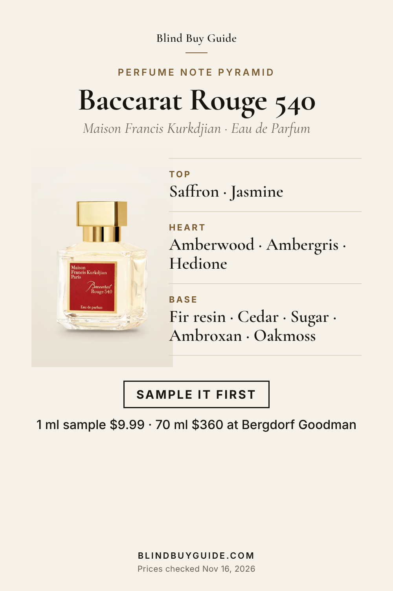

- **Board:** Perfume Note Pyramids
- **Post:** day 1
- **Title:** Baccarat Rouge 540 notes: the full perfume note pyramid
- **Description:** Baccarat Rouge 540 notes, top to base: saffron and jasmine, then amberwood, ambergris and hedione, on fir resin, cedar and ambroxan. See the full Maison Francis Kurkdjian note pyramid, our sample-first verdict, and what a 1 ml sample costs before the $360 bottle (prices checked Nov 16, 2026). Affiliate links on the page. #ad #perfumenotes
- **Destination URL:** https://www.blindbuyguide.com/scents/baccarat-rouge-540-edp/
- **Alt text:** Perfume note pyramid for Maison Francis Kurkdjian Baccarat Rouge 540 Eau de Parfum beside a photo of the bottle on a cream background. Top notes: saffron, jasmine. Heart: amberwood, ambergris, hedione. Base: fir resin, cedar, sugar, ambroxan, oakmoss. Verdict: sample it first. 1 ml sample $9.99; 70 ml $360 at Bergdorf Goodman.

### 02. Should you blind buy Creed Green Irish Tweed? The verdict and the price

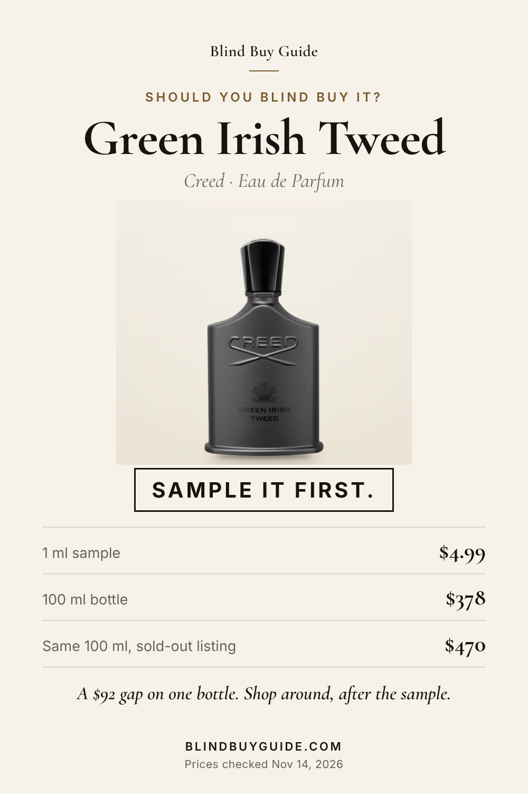

- **Board:** Sample First Perfumes
- **Post:** day 1
- **Title:** Should you blind buy Creed Green Irish Tweed? The verdict and the price
- **Description:** Should you blind buy Creed Green Irish Tweed? Our verdict: sample it first. A 1 ml sample is $4.99, while the 100 ml bottle was $378 in stock at Niche Beauty and listed at $470 for the same size at a shop that was sold out (Nov 14, 2026). Notes, price per ml and where to sample this classic green men's fragrance. Affiliate links on the page. #ad #creed
- **Destination URL:** https://www.blindbuyguide.com/guides/is-creed-green-irish-tweed-edp-worth-it/
- **Alt text:** Photo of a Creed Green Irish Tweed Eau de Parfum bottle on a cream background under the headline 'Should you blind buy Green Irish Tweed?' The answer reads 'Sample it first.' A 1 ml sample costs $4.99; the 100 ml bottle is $378 at Niche Beauty, and the same 100 ml was listed at $470 at a shop that was sold out.

### 03. Is Parfums de Marly Delina worth it? Price per ml, by bottle size

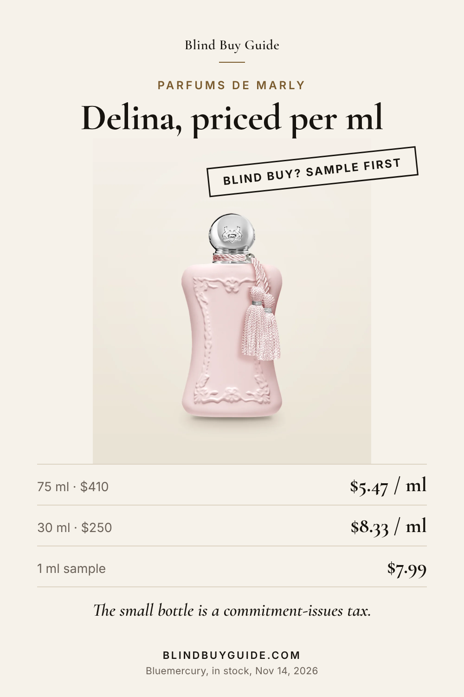

- **Board:** Niche Perfumes
- **Post:** day 2
- **Title:** Is Parfums de Marly Delina worth it? Price per ml, by bottle size
- **Description:** Is Parfums de Marly Delina worth it? Sample it first, then go big: the 75 ml at $410 (Bluemercury) works out to $5.47 per ml, against $8.33 per ml for the 30 ml at $250 (Nov 14, 2026). A 1 ml sample is $7.99. Notes include lychee, rhubarb, Turkish rose, peony, cashmeran and vetiver. Affiliate links on the page. #ad #nicheperfume
- **Destination URL:** https://www.blindbuyguide.com/guides/is-delina-edp-worth-it/
- **Alt text:** Editorial photo of the pink Parfums de Marly Delina Eau de Parfum bottle on a cream background with a small stamp reading 'Blind buy? Sample first.' Caption: 75 ml at $410 is $5.47 per ml; 30 ml at $250 is $8.33 per ml; 1 ml sample $7.99.

### 04. Tom Ford Tobacco Vanille at a glance: notes, longevity, price per ml

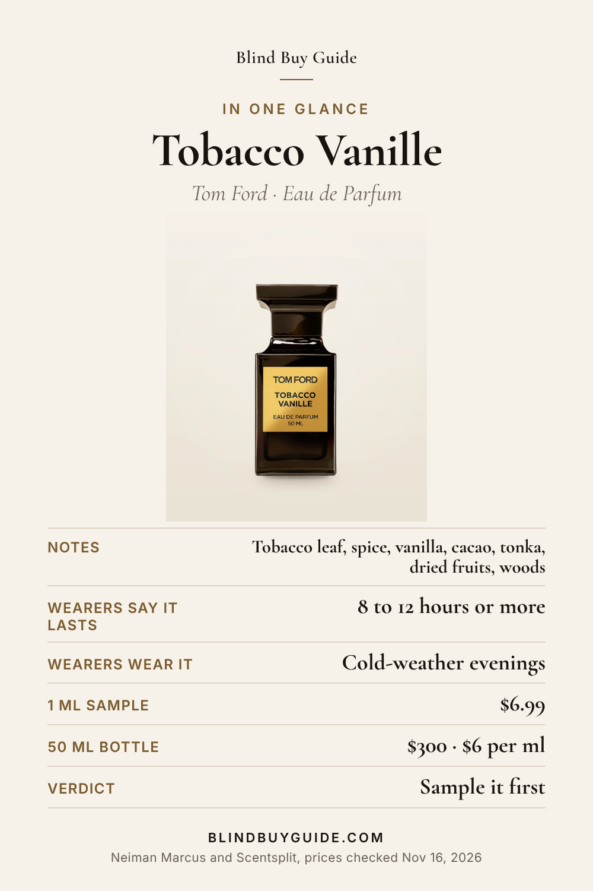

- **Board:** Designer Perfumes
- **Post:** day 2
- **Title:** Tom Ford Tobacco Vanille at a glance: notes, longevity, price per ml
- **Description:** Tom Ford Tobacco Vanille at a glance: tobacco leaf and spice over vanilla, cacao and tonka. Wearers mostly report 8 to 12 hours or more and save it for cold-weather evenings. A 1 ml sample is $6.99; the 50 ml is $300 at Neiman Marcus, $6 per ml (Nov 16, 2026). Our verdict: sample it first. Affiliate links on the page. #ad #tomford
- **Destination URL:** https://www.blindbuyguide.com/scents/tom-ford-tobacco-vanille-edp/
- **Alt text:** One-glance cheat sheet for Tom Ford Tobacco Vanille Eau de Parfum with a photo of the bottle on cream. Notes: tobacco leaf, spice, vanilla, cacao, tonka bean, dried fruits, woods. Wearers say: 8 to 12 hours or more; best on cold-weather evenings. 1 ml sample $6.99. 50 ml $300 at Neiman Marcus, $6 per ml. Verdict: sample it first.

### 05. Perfume sample vs bottle: the Oud Satin Mood price per ml math

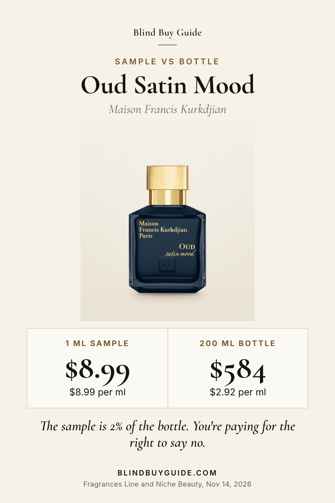

- **Board:** Sample First Perfumes
- **Post:** day 3
- **Title:** Perfume sample vs bottle: the Oud Satin Mood price per ml math
- **Description:** Perfume sample vs bottle, in real numbers: a 1 ml sample of Maison Francis Kurkdjian Oud Satin Mood is $8.99, and the 200 ml bottle is $584 at Niche Beauty, or $2.92 per ml (Nov 14, 2026). The sample costs more per ml and about 2% of the bottle. That is the price of being allowed to say no. Affiliate links on the page. #ad #perfumesample
- **Destination URL:** https://www.blindbuyguide.com/guides/is-oud-satin-mood-edp-worth-it/
- **Alt text:** Price comparison card for Maison Francis Kurkdjian Oud Satin Mood Eau de Parfum with a bottle photo on cream. 1 ml sample: $8.99, which is $8.99 per ml. 200 ml bottle: $584, which is $2.92 per ml. The sample is about 2% of the bottle price. Verdict: sample first.

### 06. Byredo Gypsy Water notes, explained

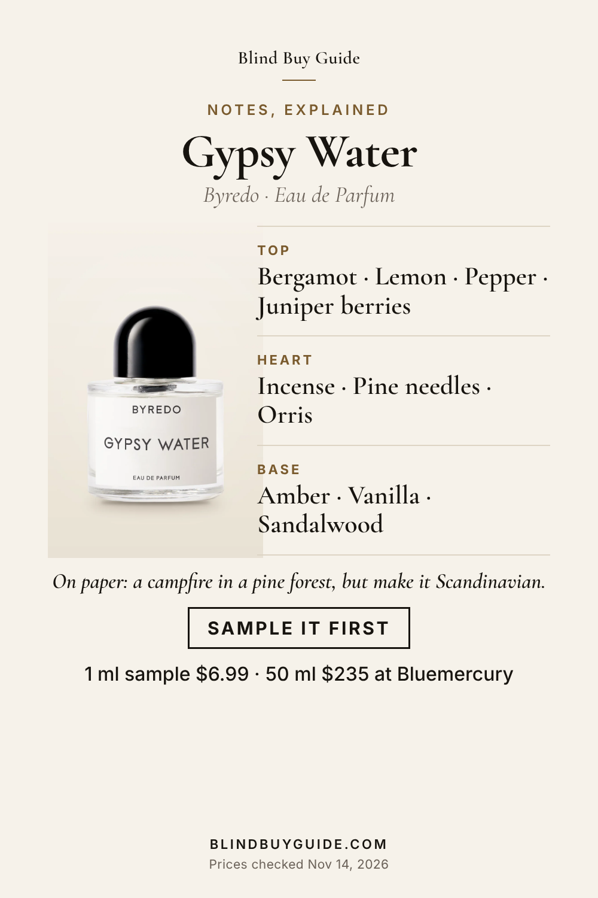

- **Board:** Perfume Note Pyramids
- **Post:** day 3
- **Title:** Byredo Gypsy Water notes, explained
- **Description:** Byredo Gypsy Water notes, explained: bergamot, lemon, pepper and juniper berries up top, incense, pine needles and orris in the heart, amber, vanilla and sandalwood in the base. Read what the note list adds up to, plus the sample-first verdict: 1 ml is $6.99 and the 50 ml is $235 at Bluemercury (Nov 14, 2026). Affiliate links on the page. #ad #perfumenotes
- **Destination URL:** https://www.blindbuyguide.com/guides/is-gypsy-water-edp-worth-it/
- **Alt text:** Note pyramid for Byredo Gypsy Water Eau de Parfum with a photo of the bottle on cream. Top: bergamot, lemon, pepper, juniper berries. Heart: incense, pine needles, orris. Base: amber, vanilla, sandalwood. Verdict: sample it first. 1 ml sample $6.99; 50 ml $235 at Bluemercury.

### 07. Should you blind buy perfume? The $150 rule for niche fragrance

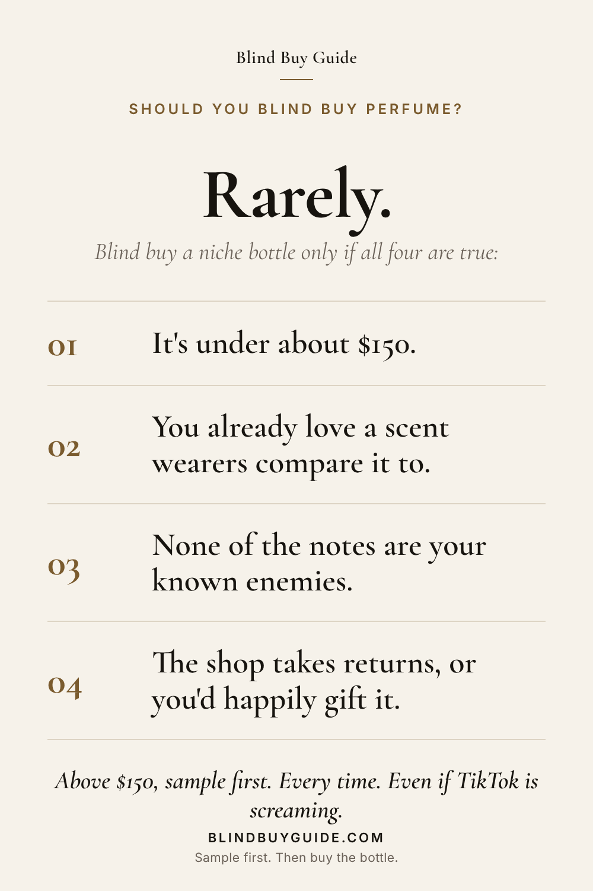

- **Board:** Safe Blind Buy Perfumes
- **Post:** day 1
- **Title:** Should you blind buy perfume? The $150 rule for niche fragrance
- **Description:** Should you blind buy perfume? For niche fragrance, rarely. Blind buy only if the bottle is under about $150, you already love a similar scent, none of the notes are your known enemies, and the shop takes returns. Above $150, sample first: a 2 ml sample typically costs around $13. Affiliate links on the page. #ad #blindbuy
- **Destination URL:** https://www.blindbuyguide.com/guides/should-you-blind-buy-niche-fragrance/
- **Alt text:** Typographic card on cream titled 'Should you blind buy a niche perfume? Rarely.' It lists the $150 rule: blind buy only if the bottle is under about $150, you already love a scent wearers compare it to, none of the notes are your known enemies, and the shop takes returns. Above $150, sample first.

### 08. The most expensive perfumes per ml: sample these first

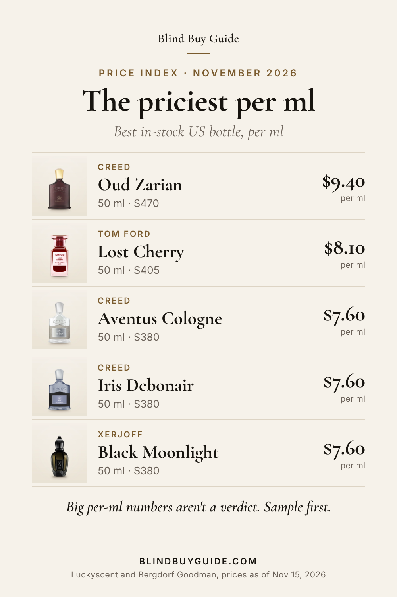

- **Board:** Sample First Perfumes
- **Post:** day 4
- **Title:** The most expensive perfumes per ml: sample these first
- **Description:** The most expensive perfumes per ml in our November 2026 price index, best in-stock US bottle: Creed Oud Zarian at $9.40 per ml, Tom Ford Lost Cherry at $8.10, and Creed Aventus Cologne, Creed Iris Debonair and Xerjoff Black Moonlight at $7.60. Big per-ml numbers are not a verdict; they are the reason to buy a perfume sample first. Affiliate links on the page. #ad #nicheperfume
- **Destination URL:** https://www.blindbuyguide.com/guides/blind-buy-guide-price-index-november-2026/
- **Alt text:** List of the five most expensive perfumes per ml with small bottle photos on cream: Creed Oud Zarian $9.40 per ml (50 ml, $470), Tom Ford Lost Cherry $8.10 per ml (50 ml, $405), Creed Aventus Cologne $7.60 per ml (50 ml, $380), Creed Iris Debonair $7.60 per ml (50 ml, $380), Xerjoff Black Moonlight $7.60 per ml (50 ml, $380).

### 09. Winter perfumes for the cozy maximalist: 3 warm luxury bottles

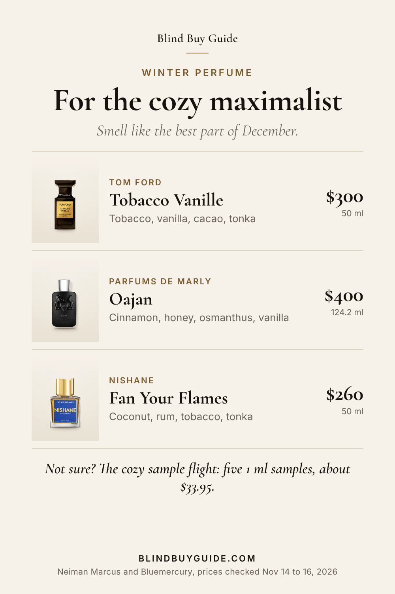

- **Board:** Winter Perfumes
- **Post:** day 2
- **Title:** Winter perfumes for the cozy maximalist: 3 warm luxury bottles
- **Description:** Winter perfume for the cozy maximalist: Tom Ford Tobacco Vanille ($300, 50 ml), Parfums de Marly Oajan ($400, 124.2 ml) and Nishane Fan Your Flames ($260, 50 ml), with notes and the sample that tells you if it's the one. Or start with the cozy sample flight: five 1 ml samples for about $33.95. Prices checked Nov 14 to 16, 2026. Affiliate links on the page. #ad #winterperfume
- **Destination URL:** https://www.blindbuyguide.com/gift-guide/#cozy
- **Alt text:** Three warm winter perfumes with bottle photos on cream: Tom Ford Tobacco Vanille, $300 for 50 ml; Parfums de Marly Oajan, $400 for 124.2 ml; Nishane Fan Your Flames, $260 for 50 ml. Below, the cozy sample flight: five 1 ml samples for about $33.95.

### 10. Quiet luxury perfume: 3 signature scents people notice when they lean in

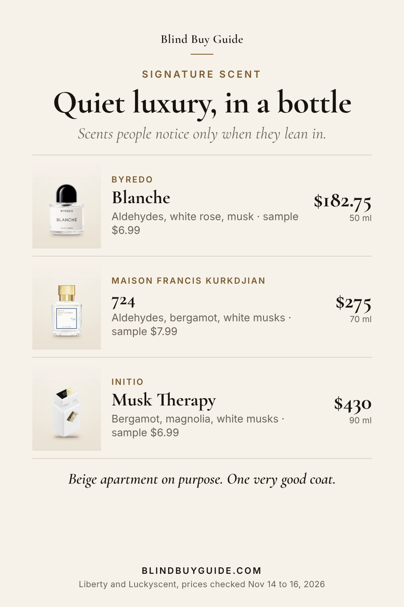

- **Board:** Signature Scent
- **Post:** day 4
- **Title:** Quiet luxury perfume: 3 signature scents people notice when they lean in
- **Description:** Quiet luxury perfume for a signature scent people notice only when they lean in: Byredo Blanche ($182.75, 50 ml), Maison Francis Kurkdjian 724 ($275, 70 ml) and Initio Musk Therapy ($430, 90 ml). Clean aldehydes, white flowers and musks, with the 1 ml sample price for each. Prices checked Nov 14 to 16, 2026. Affiliate links on the page. #ad #signaturescent
- **Destination URL:** https://www.blindbuyguide.com/gift-guide/#quiet-luxury
- **Alt text:** Three quiet luxury perfumes with bottle photos on cream: Byredo Blanche, $182.75 for 50 ml; Maison Francis Kurkdjian 724, $275 for 70 ml; Initio Musk Therapy, $430 for 90 ml. Each lists its main notes and a 1 ml sample price.

### 11. Baccarat Rouge 540 vs Oud Satin Mood: which Kurkdjian to sample first

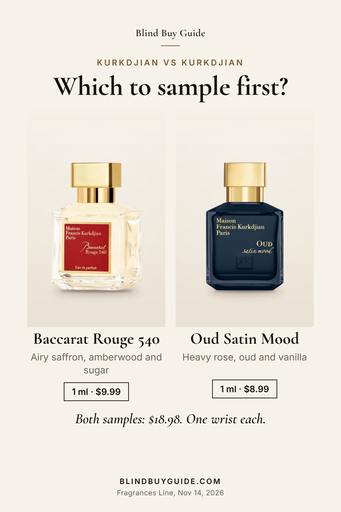

- **Board:** Niche Perfumes
- **Post:** day 5
- **Title:** Baccarat Rouge 540 vs Oud Satin Mood: which Kurkdjian to sample first
- **Description:** Baccarat Rouge 540 vs Oud Satin Mood, two Maison Francis Kurkdjian heavyweights side by side: Baccarat Rouge 540 is airy saffron, amberwood and sugar; Oud Satin Mood is heavy rose, oud and vanilla. Notes, bottle prices and samples ($9.99 and $8.99 for 1 ml, Nov 14, 2026). Affiliate links on the page. #ad #nicheperfume
- **Destination URL:** https://www.blindbuyguide.com/compare/baccarat-rouge-540-edp-vs-oud-satin-mood-edp/
- **Alt text:** Side-by-side comparison on cream with two bottle photos. Left: Maison Francis Kurkdjian Baccarat Rouge 540, airy saffron, amberwood and sugar, 1 ml sample $9.99. Right: Maison Francis Kurkdjian Oud Satin Mood, heavy rose, oud and vanilla, 1 ml sample $8.99.

### 12. Layton vs Herod: which Parfums de Marly for winter?

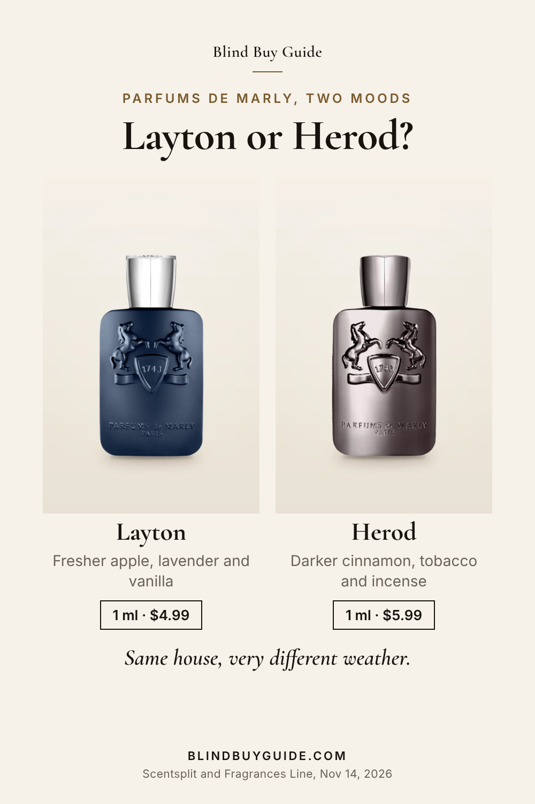

- **Board:** Winter Perfumes
- **Post:** day 5
- **Title:** Layton vs Herod: which Parfums de Marly for winter?
- **Description:** Parfums de Marly Layton vs Herod for winter: Layton is the fresher apple, lavender and vanilla crowd-pleaser; Herod is darker cinnamon, tobacco and incense, the notes most people save for cold weather. Compare the notes and sample both first: $4.99 and $5.99 for 1 ml (Nov 14, 2026). Affiliate links on the page. #ad #winterperfume
- **Destination URL:** https://www.blindbuyguide.com/compare/layton-vs-herod-edp/
- **Alt text:** Side-by-side comparison on cream with two bottle photos. Left: Parfums de Marly Layton, apple, lavender and vanilla, 1 ml sample $4.99. Right: Parfums de Marly Herod, cinnamon, tobacco and incense, 1 ml sample $5.99.

### 13. The safe blind buy: luxury perfume discovery sets worth it (2026)

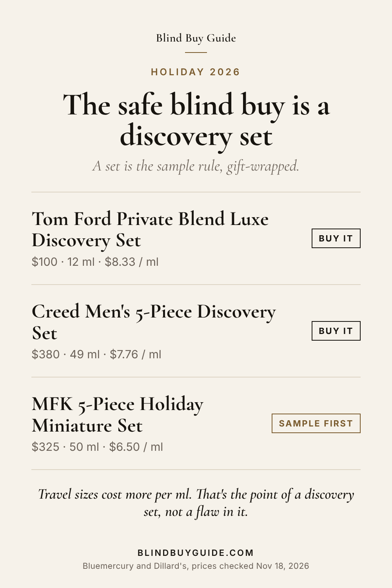

- **Board:** Safe Blind Buy Perfumes
- **Post:** day 3
- **Title:** The safe blind buy: luxury perfume discovery sets worth it (2026)
- **Description:** The safest perfume blind buy is a discovery set. Of the luxury sets we priced on Nov 18, 2026, we'd buy the Tom Ford Private Blend Luxe Discovery Set ($100, 12 ml) and the Creed Men's 5-Piece Discovery Set ($380, 49 ml); the MFK 5-Piece Holiday Miniature Set ($325, 50 ml) is a sample-first. Per-ml math and how to choose. #perfumegift #discoveryset
- **Destination URL:** https://www.blindbuyguide.com/guides/holiday-fragrance-gift-sets-worth-it/
- **Alt text:** Typographic table on cream titled 'The safe blind buy: discovery sets.' Tom Ford Private Blend Luxe Discovery Set, $100 for 12 ml, $8.33 per ml, buy it. Creed Men's 5-Piece Discovery Set, $380 for 49 ml, $7.76 per ml, buy it. MFK 5-Piece Holiday Miniature Set, $325 for 50 ml, $6.50 per ml, sample it first.

### 14. How perfume notes unfold on skin: top, heart and drydown

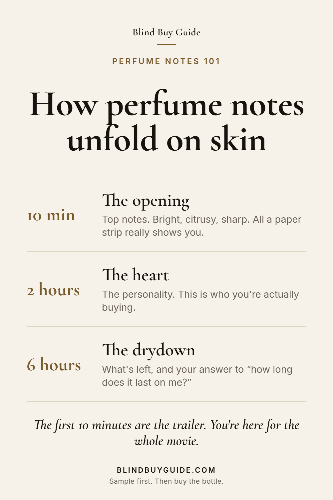

- **Board:** Perfume Note Pyramids
- **Post:** day 6
- **Title:** How perfume notes unfold on skin: top, heart and drydown
- **Description:** How perfume notes work on skin: check a fragrance at 10 minutes for the top notes, at 2 hours for the heart, and at 6 hours for the drydown. That is why the paper strip lies, and why one sniff in a store is not a test. The full step-by-step way to test a fragrance before you buy the bottle. #perfumenotes #perfumetips
- **Destination URL:** https://www.blindbuyguide.com/guides/how-to-test-a-fragrance/
- **Alt text:** Typographic timeline on cream titled 'How perfume notes unfold on skin.' 10 minutes: the opening, top notes, bright and sharp, what a paper strip shows. 2 hours: the heart, the personality. 6 hours: the drydown, and your answer to how long it lasts on you.

### 15. Perfume sample sizes: should you buy 1 ml, 2 ml or 5 ml?

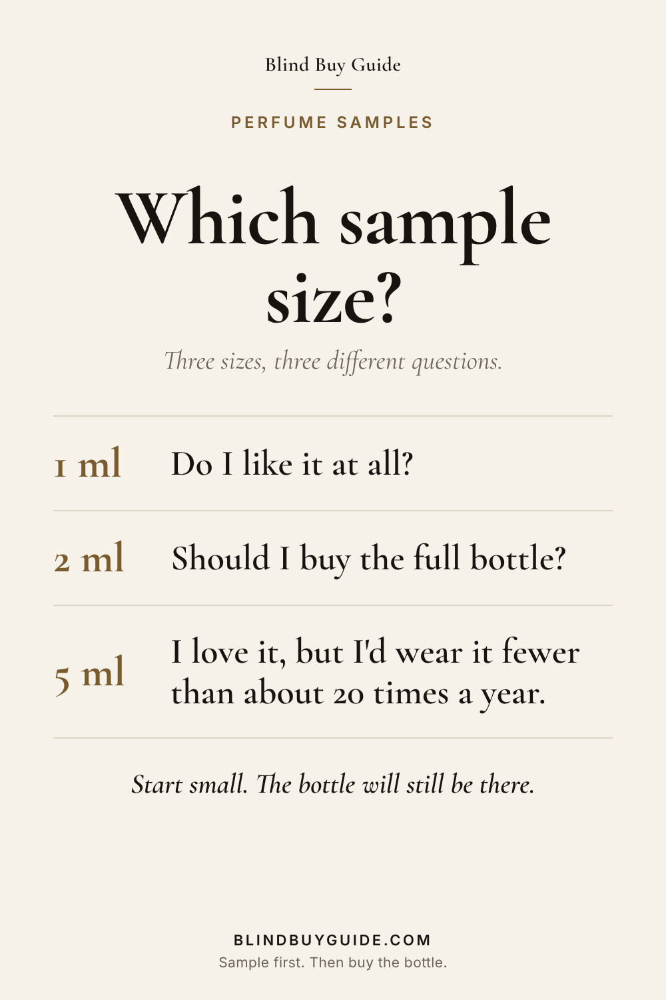

- **Board:** Sample First Perfumes
- **Post:** day 6
- **Title:** Perfume sample sizes: should you buy 1 ml, 2 ml or 5 ml?
- **Description:** Which perfume sample size to buy: 1 ml to find out if you like a scent at all, 2 ml when you are seriously considering the full bottle, and 5 ml when you love it but would wear it fewer than about 20 times a year. A quick guide to perfume samples and decants before a luxury bottle. Affiliate links on the page. #ad #perfumesample
- **Destination URL:** https://www.blindbuyguide.com/guides/which-sample-size-to-buy/
- **Alt text:** Typographic card on cream titled 'Which perfume sample size?' 1 ml: do I like it at all? 2 ml: should I buy the bottle? 5 ml: I love it, but I'd wear it fewer than about 20 times a year.

### 16. Tom Ford Black Orchid vs Noir de Noir: which dark perfume to sample

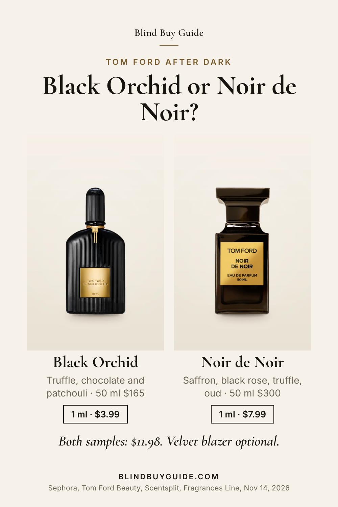

- **Board:** Designer Perfumes
- **Post:** day 7
- **Title:** Tom Ford Black Orchid vs Noir de Noir: which dark perfume to sample
- **Description:** Tom Ford Black Orchid vs Noir de Noir, Tom Ford after dark: Black Orchid lists jasmine, black truffle and ylang-ylang on patchouli and dark chocolate; Noir de Noir lists saffron, black rose and truffle on vanilla and oud. Bottles: $165 vs $300 for 50 ml. A 1 ml of each costs $11.98 together (Nov 14, 2026). Affiliate links on the page. #ad #tomford
- **Destination URL:** https://www.blindbuyguide.com/compare/black-orchid-edp-vs-tom-ford-noir-de-noir-edp/
- **Alt text:** Side-by-side comparison on cream with two Tom Ford bottle photos. Left: Black Orchid, truffle, chocolate and patchouli, 50 ml $165, 1 ml sample $3.99. Right: Noir de Noir, saffron, black rose, truffle and oud, 50 ml $300, 1 ml sample $7.99.

### 17. Perfume gift idea: give a sample flight, then the bottle they choose

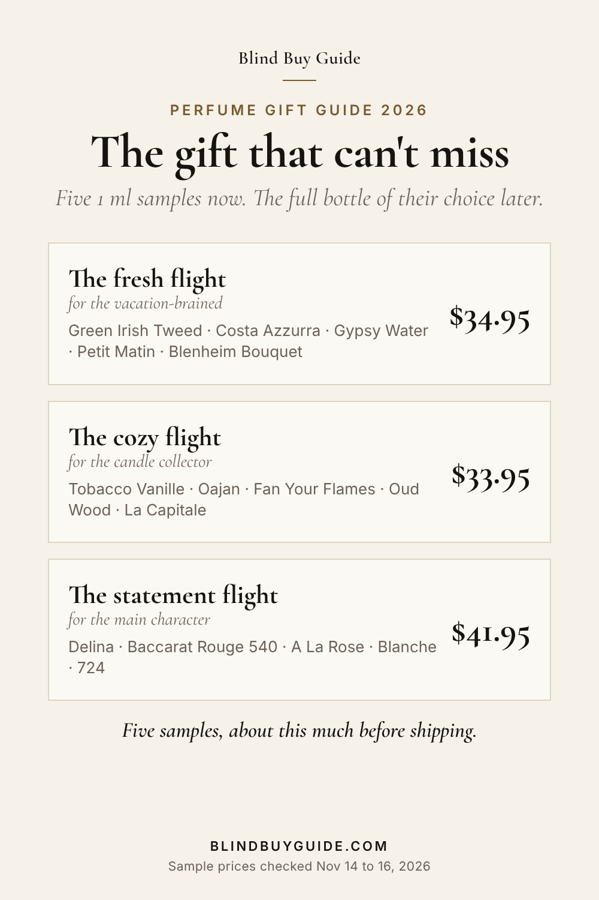

- **Board:** Perfume Gift Guide
- **Post:** day 4
- **Title:** Perfume gift idea: give a sample flight, then the bottle they choose
- **Description:** The perfume gift that can't miss: five 1 ml samples in a box with a card that says the full bottle is on you once they've chosen. Three luxury sample flights from our 2026 gift guide, the fresh, the cozy and the statement, each about $34 to $42 before shipping. Order by the first week of December. Affiliate links on the page. #ad #perfumegift
- **Destination URL:** https://www.blindbuyguide.com/gift-guide/#samples
- **Alt text:** Gift card-style design on cream titled 'The perfume gift that can't miss.' Three sample flights of five 1 ml samples: the fresh flight about $34.95 (Green Irish Tweed, Costa Azzurra, Gypsy Water, Petit Matin, Blenheim Bouquet); the cozy flight about $33.95 (Tobacco Vanille, Oajan, Fan Your Flames, Oud Wood, La Capitale); the statement flight about $41.95 (Delina, Baccarat Rouge 540, A La Rose, Blanche, 724).

### 18. Valentine's Day perfume gifts for the main character

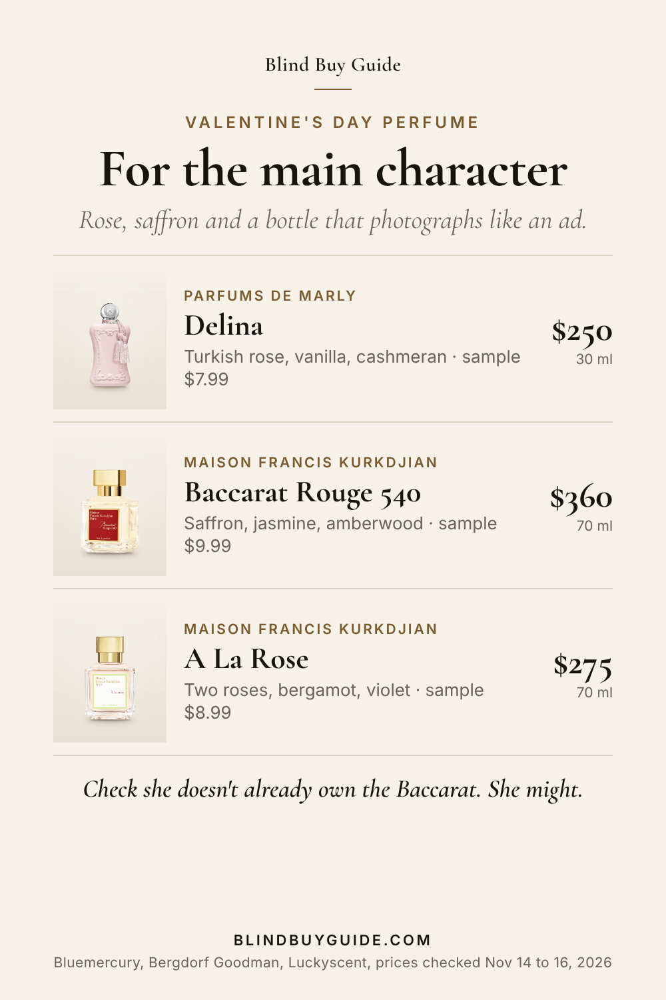

- **Board:** Date Night Perfume
- **Post:** hold until Jan 2-5, 2027
- **Title:** Valentine's Day perfume gifts for the main character
- **Description:** Valentine's Day perfume for the main character: Parfums de Marly Delina ($250, 30 ml), Maison Francis Kurkdjian Baccarat Rouge 540 ($360, 70 ml) and MFK A La Rose ($275, 70 ml). Rose, saffron and amberwood from luxury houses, with the 1 ml sample to confirm before you commit. Re-check prices on posting day. Affiliate links on the page. #ad #valentinesgift
- **Destination URL:** https://www.blindbuyguide.com/gift-guide/#main-character
- **Alt text:** Three Valentine's Day perfume gifts with bottle photos on cream: Parfums de Marly Delina, $250 for 30 ml; Maison Francis Kurkdjian Baccarat Rouge 540, $360 for 70 ml; Maison Francis Kurkdjian A La Rose, $275 for 70 ml. Each lists its main notes and a 1 ml sample price.

### 19. Find your signature scent: a 9-question perfume quiz

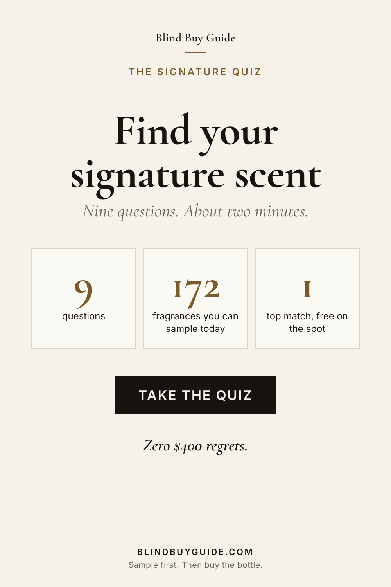

- **Board:** Signature Scent
- **Post:** day 5
- **Title:** Find your signature scent: a 9-question perfume quiz
- **Description:** Find your signature scent with a free 9-question perfume quiz. About two minutes; every answer is scored against the notes, concentration and prices of 172 fragrances you can sample today. Your top match is free on the spot, with why it fits and the best sample price we track. The full five picks and a testing plan come by email with the free Price Book. #signaturescent #perfumequiz
- **Destination URL:** https://www.blindbuyguide.com/find/
- **Alt text:** Typographic quiz card on cream reading 'Find your signature scent.' Nine questions, about two minutes. Scored against 172 fragrances you can sample today. Your top match is free on the spot. Below: 'Zero $400 regrets.'

### 20. Niche perfume price per ml, by house (November 2026)

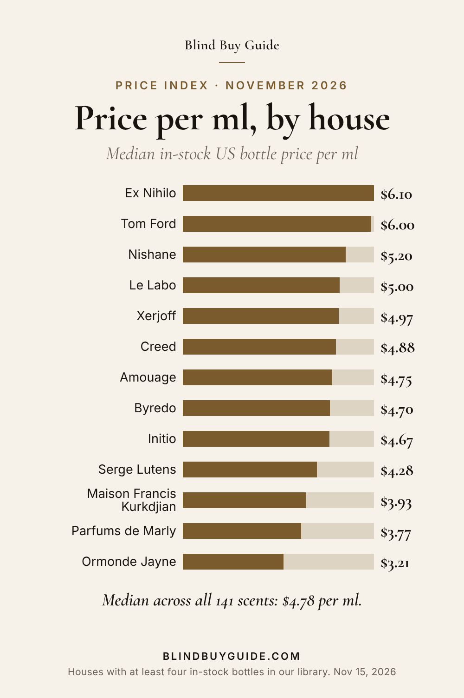

- **Board:** Niche Perfumes
- **Post:** day 7
- **Title:** Niche perfume price per ml, by house (November 2026)
- **Description:** Niche perfume price per ml, by house: the median in-stock US bottle runs from $3.21 per ml at Ormonde Jayne to $6.10 at Ex Nihilo, with Tom Ford, Nishane, Le Labo, Xerjoff, Creed, Amouage, Byredo, Initio, Serge Lutens, MFK and Parfums de Marly in between. From the Blind Buy Guide Price Index, November 2026. Affiliate links on the page. #ad #nicheperfume
- **Destination URL:** https://www.blindbuyguide.com/guides/blind-buy-guide-price-index-november-2026/
- **Alt text:** Horizontal bar chart on cream: median bottle price per ml by niche house, November 2026. Ex Nihilo $6.10, Tom Ford $6, Nishane $5.20, Le Labo $5, Xerjoff $4.97, Creed $4.88, Amouage $4.75, Byredo $4.70, Initio $4.67, Serge Lutens $4.28, Maison Francis Kurkdjian $3.93, Parfums de Marly $3.77, Ormonde Jayne $3.21.
