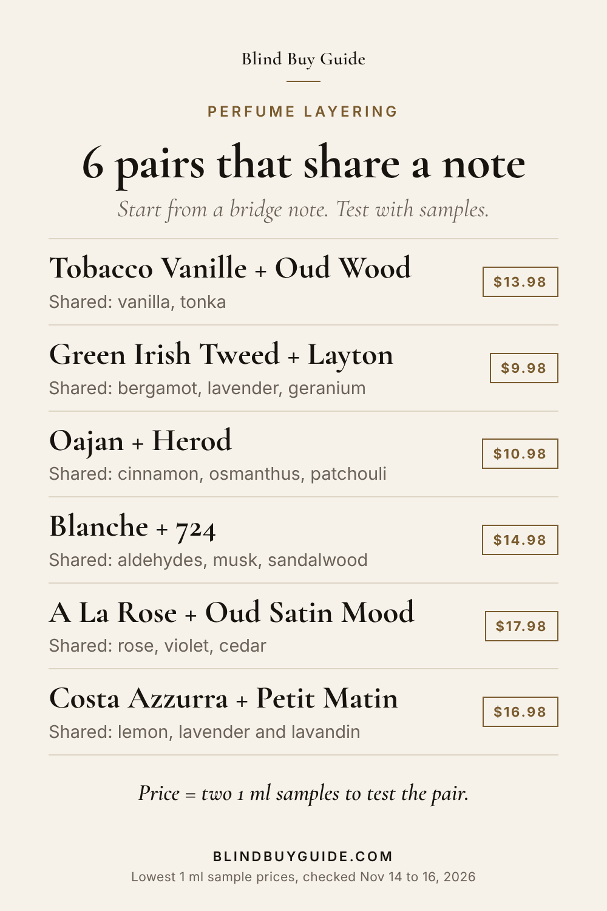
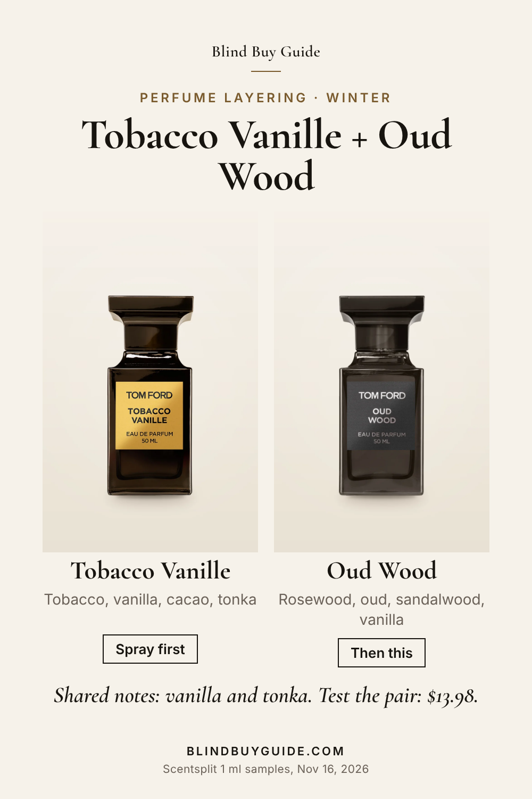
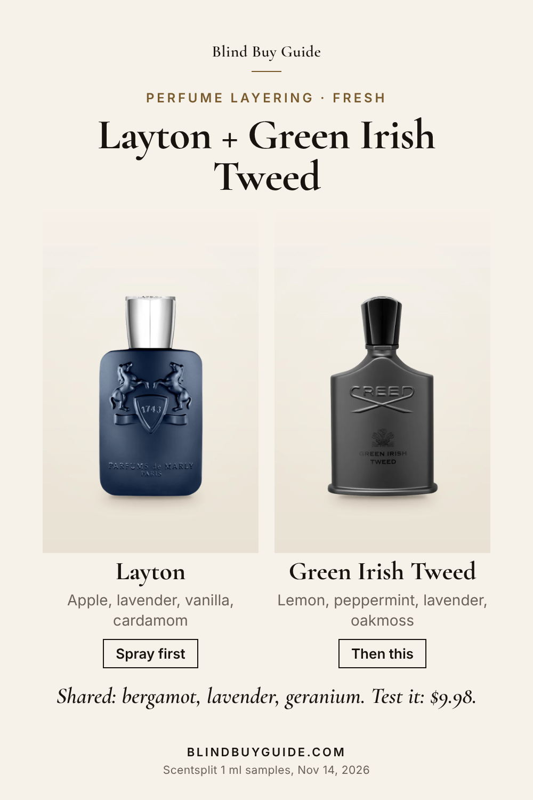
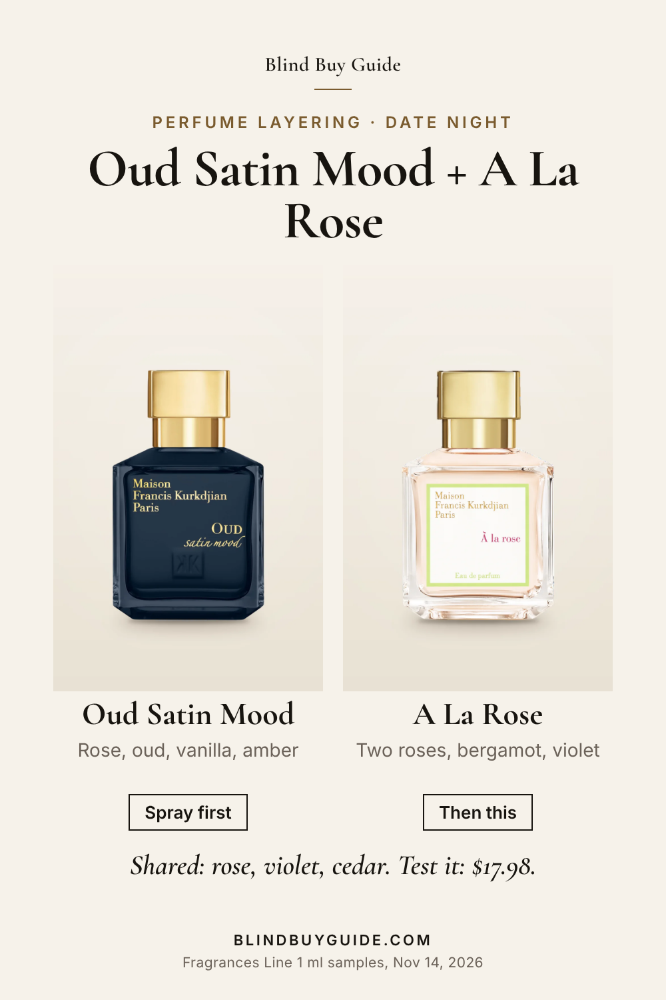
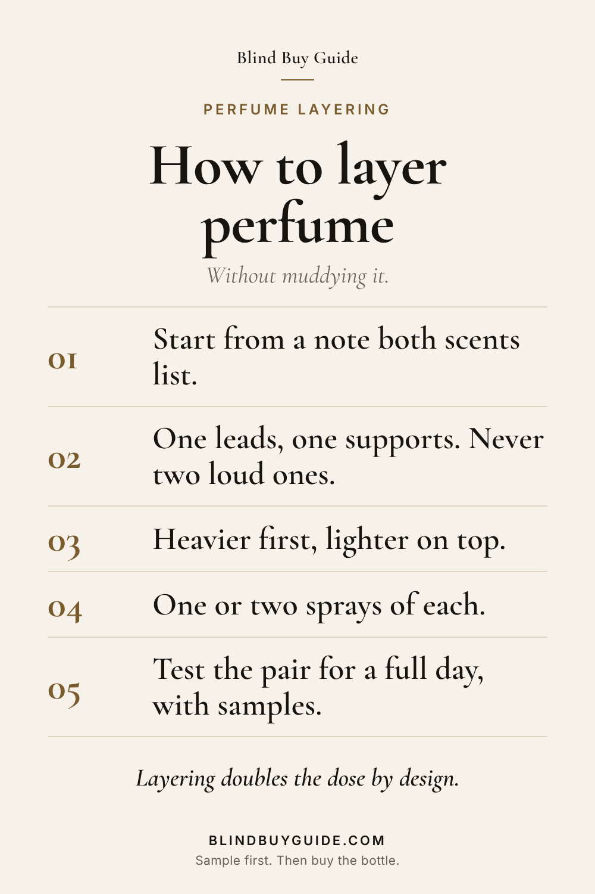
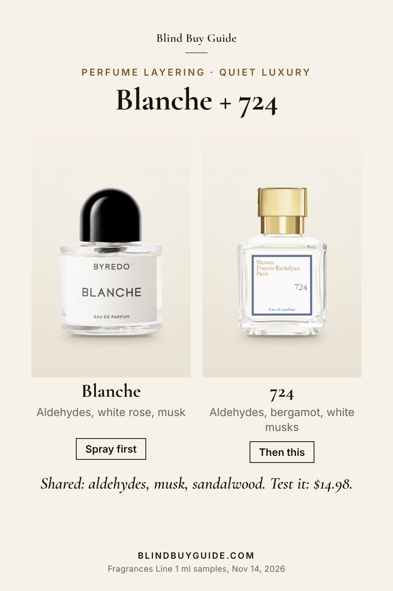
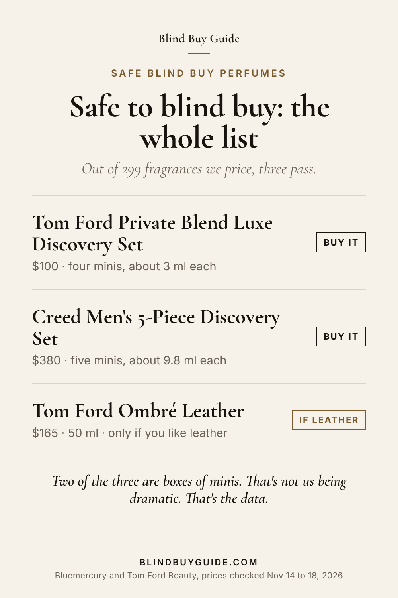
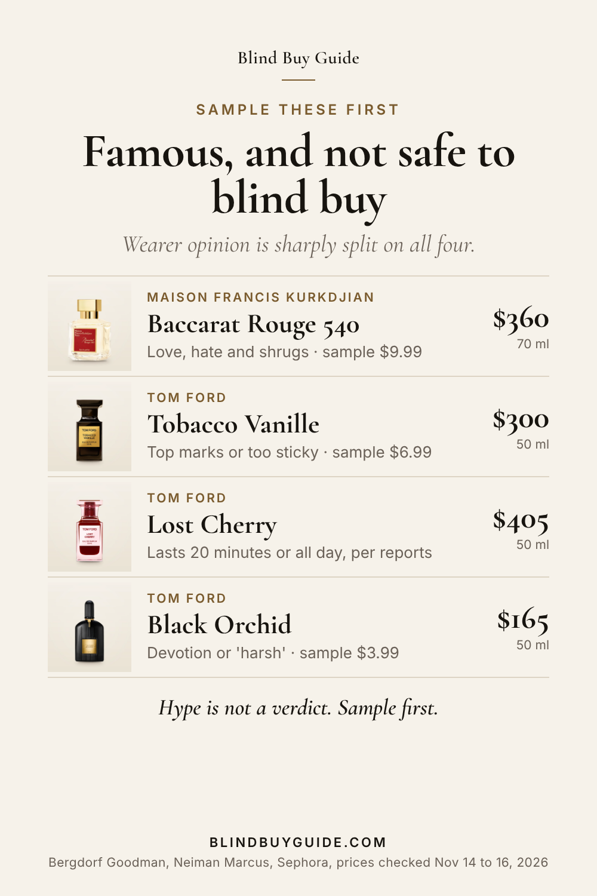
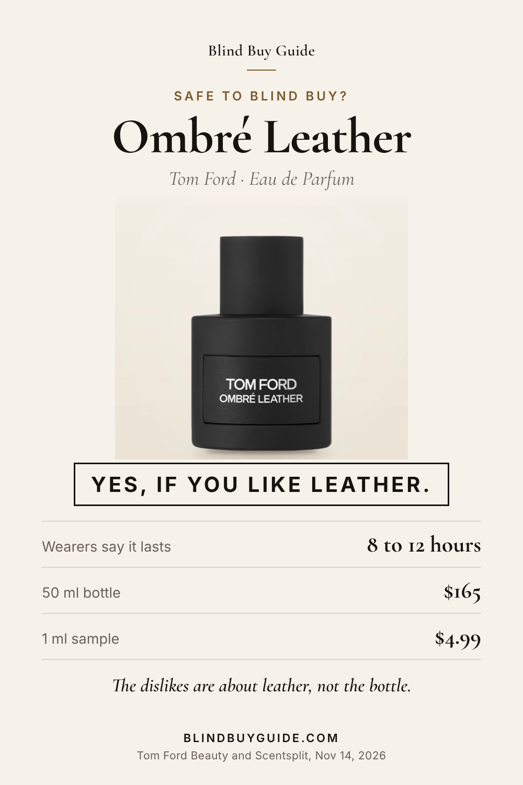

# Pinterest batch 2: layering and safe blind buy pins

9 pins for the two new site pages, [/guides/perfume-layering-combinations/](https://www.blindbuyguide.com/guides/perfume-layering-combinations/) and [/guides/safe-blind-buy-perfumes/](https://www.blindbuyguide.com/guides/safe-blind-buy-perfumes/). Same format, boards and posting rules as [batch 1](../batch-1/README.md). **Nothing has been posted.**

- Re-render: `node tools/pinterest/render.mjs docs/social/pinterest/batch-2/pins.json [pin-id]`.
- This batch starts the Perfume Layering Combinations board. Layering pins land on the layering guide; pin 22 also seeds Winter Perfumes, 24 Date Night Perfume and 26 Signature Scent.
- Layering pairs are matched on the houses' published note lists, never on anyone having worn them; the copy says "shared notes", not "smells like".
- Interleave with batch 1 at about 3 pins a day. Day numbers below are relative to the day you start this batch.

## Pins at a glance

| Pin | Day | Board | Title | Destination |
|---|---|---|---|---|
| [21](21-perfume-layering-combinations-6-pairs.png) | 1 | Perfume Layering Combinations | Perfume layering combinations: 6 luxury pairs that share a note | /guides/perfume-layering-combinations/ |
| [22](22-layer-tobacco-vanille-oud-wood.png) | 1 | Winter Perfumes | Winter perfume layering: Tobacco Vanille + Oud Wood | /guides/perfume-layering-combinations/ |
| [23](23-layer-green-irish-tweed-layton.png) | 2 | Perfume Layering Combinations | Perfume layering for men: Green Irish Tweed + Layton | /guides/perfume-layering-combinations/ |
| [24](24-layer-a-la-rose-oud-satin-mood.png) | 3 | Date Night Perfume | Date night perfume layering: A La Rose + Oud Satin Mood | /guides/perfume-layering-combinations/ |
| [25](25-how-to-layer-perfume.png) | 2 | Perfume Layering Combinations | How to layer perfume without muddying it | /guides/perfume-layering-combinations/ |
| [26](26-layer-blanche-724-quiet-luxury.png) | 4 | Signature Scent | Quiet luxury perfume layering: Blanche + 724 | /guides/perfume-layering-combinations/ |
| [27](27-safe-blind-buy-perfumes-list.png) | 1 | Safe Blind Buy Perfumes | Safe blind buy perfumes: the short, honest list (2026) | /guides/safe-blind-buy-perfumes/ |
| [28](28-famous-perfumes-not-safe-to-blind-buy.png) | 3 | Sample First Perfumes | Famous perfumes that aren't safe to blind buy (sample these first) | /guides/safe-blind-buy-perfumes/ |
| [29](29-ombre-leather-safe-blind-buy.png) | 4 | Designer Perfumes | Is Tom Ford Ombré Leather a safe blind buy? Yes, if you like leather | /guides/safe-blind-buy-perfumes/ |

## Pin copy (paste-ready)

### 21. Perfume layering combinations: 6 luxury pairs that share a note

- **Board:** Perfume Layering Combinations
- **Post:** day 1
- **Title:** Perfume layering combinations: 6 luxury pairs that share a note
- **Description:** Perfume layering combinations that start from a shared note: Tobacco Vanille + Oud Wood, Green Irish Tweed + Layton, Oajan + Herod, Blanche + 724, A La Rose + Oud Satin Mood, and Costa Azzurra + Petit Matin. How to layer each pair, and what it costs to test with two 1 ml samples ($9.98 to $17.98). Affiliate links on the page. #ad #perfumelayering
- **Destination URL:** https://www.blindbuyguide.com/guides/perfume-layering-combinations/
- **Alt text:** Typographic list on cream titled 'Perfume layering combinations: 6 pairs that share a note.' Tobacco Vanille + Oud Wood share vanilla and tonka. Green Irish Tweed + Layton share bergamot, lavender and geranium. Oajan + Herod share cinnamon, osmanthus and patchouli. Blanche + 724 share aldehydes. A La Rose + Oud Satin Mood share rose, violet and cedar. Costa Azzurra + Petit Matin share lemon. Each pair shows its sample test cost.

### 22. Winter perfume layering: Tobacco Vanille + Oud Wood

- **Board:** Winter Perfumes
- **Post:** day 1
- **Title:** Winter perfume layering: Tobacco Vanille + Oud Wood
- **Description:** A winter perfume layering combination from one house: Tom Ford Tobacco Vanille and Tom Ford Oud Wood both list vanilla and tonka bean, so the pair has a bridge. Spray Tobacco Vanille first, Oud Wood over it, one or two sprays each. Test the pair for $13.98 in samples before two $300 bottles. Affiliate links on the page. #ad #perfumelayering
- **Destination URL:** https://www.blindbuyguide.com/guides/perfume-layering-combinations/
- **Alt text:** Two Tom Ford bottles side by side on cream under the headline 'Tobacco Vanille + Oud Wood.' Left: Tobacco Vanille, tobacco, vanilla, cacao, tonka, spray first. Right: Oud Wood, rosewood, oud, sandalwood, vanilla, spray second. Shared notes: vanilla and tonka. Two 1 ml samples cost $13.98.

### 23. Perfume layering for men: Green Irish Tweed + Layton

- **Board:** Perfume Layering Combinations
- **Post:** day 2
- **Title:** Perfume layering for men: Green Irish Tweed + Layton
- **Description:** A fresh perfume layering combination: Creed Green Irish Tweed and Parfums de Marly Layton share bergamot, lavender and geranium on their note lists, the most overlap of any pair in our guide. Layton first, Green Irish Tweed on top. Test it with two 1 ml samples for $9.98. Affiliate links on the page. #ad #perfumelayering
- **Destination URL:** https://www.blindbuyguide.com/guides/perfume-layering-combinations/
- **Alt text:** Two bottles side by side on cream under the headline 'Green Irish Tweed + Layton.' Left: Parfums de Marly Layton, apple, lavender, vanilla, spray first. Right: Creed Green Irish Tweed, lemon, peppermint, lavender, oakmoss, spray second. Shared notes: bergamot, lavender, geranium. Two 1 ml samples cost $9.98.

### 24. Date night perfume layering: A La Rose + Oud Satin Mood

- **Board:** Date Night Perfume
- **Post:** day 3
- **Title:** Date night perfume layering: A La Rose + Oud Satin Mood
- **Description:** A date night perfume layering combination from Maison Francis Kurkdjian: A La Rose and Oud Satin Mood share rose, violet and cedar on their note lists. Oud Satin Mood first, A La Rose over it, and go easy on the sprays. Test the pair with two 1 ml samples for $17.98. Affiliate links on the page. #ad #perfumelayering
- **Destination URL:** https://www.blindbuyguide.com/guides/perfume-layering-combinations/
- **Alt text:** Two Maison Francis Kurkdjian bottles side by side on cream under the headline 'Oud Satin Mood + A La Rose.' Left: Oud Satin Mood, rose, oud, vanilla, amber, spray first. Right: A La Rose, two roses, bergamot, violet, spray second. Shared notes: rose, violet, cedar. Two 1 ml samples cost $17.98.

### 25. How to layer perfume without muddying it

- **Board:** Perfume Layering Combinations
- **Post:** day 2
- **Title:** How to layer perfume without muddying it
- **Description:** How to layer perfume: start from a note both scents share, pair one heavy scent with one lighter one, spray the heavier first, keep it to one or two sprays each, and test the pair for a full day before buying either bottle. Six luxury layering combinations to try, with sample costs. Affiliate links on the page. #ad #perfumelayering
- **Destination URL:** https://www.blindbuyguide.com/guides/perfume-layering-combinations/
- **Alt text:** Typographic card on cream titled 'How to layer perfume.' 1: Start from a shared note. 2: One leads, one supports. 3: Heavier first, lighter on top. 4: One or two sprays of each. 5: Test the pair for a full day.

### 26. Quiet luxury perfume layering: Blanche + 724

- **Board:** Signature Scent
- **Post:** day 4
- **Title:** Quiet luxury perfume layering: Blanche + 724
- **Description:** A quiet luxury perfume layering combination for a clean signature scent: Byredo Blanche and Maison Francis Kurkdjian 724 both list aldehydes, with musk and sandalwood in both bases. Blanche first, 724 on top. Test the pair with two 1 ml samples for $14.98. Affiliate links on the page. #ad #signaturescent
- **Destination URL:** https://www.blindbuyguide.com/guides/perfume-layering-combinations/
- **Alt text:** Two bottles side by side on cream under the headline 'Blanche + 724.' Left: Byredo Blanche, aldehydes, white rose, musk, spray first. Right: Maison Francis Kurkdjian 724, aldehydes, bergamot, white musks, spray second. Shared notes: aldehydes, musk, sandalwood. Two 1 ml samples cost $14.98.

### 27. Safe blind buy perfumes: the short, honest list (2026)

- **Board:** Safe Blind Buy Perfumes
- **Post:** day 1
- **Title:** Safe blind buy perfumes: the short, honest list (2026)
- **Description:** Which perfumes are safe to blind buy? Out of 299 fragrances in our price library, only three purchases pass our test: the Tom Ford Private Blend Luxe Discovery Set ($100), the Creed Men's 5-Piece Discovery Set ($380), and Tom Ford Ombré Leather ($165 for 50 ml) if you already like leather. Here's the test and why the famous ones fail it. Affiliate links on the page. #ad #blindbuy
- **Destination URL:** https://www.blindbuyguide.com/guides/safe-blind-buy-perfumes/
- **Alt text:** Typographic list on cream titled 'Safe to blind buy: the whole list.' Tom Ford Private Blend Luxe Discovery Set, $100, four minis. Creed Men's 5-Piece Discovery Set, $380, five minis. Tom Ford Ombré Leather, $165 for 50 ml, only if you like leather. Below: out of 299 fragrances, these three pass.

### 28. Famous perfumes that aren't safe to blind buy (sample these first)

- **Board:** Sample First Perfumes
- **Post:** day 3
- **Title:** Famous perfumes that aren't safe to blind buy (sample these first)
- **Description:** Famous perfumes that aren't safe to blind buy: Baccarat Rouge 540, Tom Ford Tobacco Vanille, Lost Cherry and Black Orchid. The reviews we read are sharply split on every one, and the bottles run $165 to $405. Sample first: 1 ml costs $3.99 to $9.99. Affiliate links on the page. #ad #perfumesample
- **Destination URL:** https://www.blindbuyguide.com/guides/safe-blind-buy-perfumes/
- **Alt text:** List of four famous perfumes with bottle photos on cream under the headline 'Famous, and not safe to blind buy.' Baccarat Rouge 540, $360 for 70 ml. Tom Ford Tobacco Vanille, $300 for 50 ml. Tom Ford Lost Cherry, $405 for 50 ml. Tom Ford Black Orchid, $165 for 50 ml. Each with a note that wearer opinion is split.

### 29. Is Tom Ford Ombré Leather a safe blind buy? Yes, if you like leather

- **Board:** Designer Perfumes
- **Post:** day 4
- **Title:** Is Tom Ford Ombré Leather a safe blind buy? Yes, if you like leather
- **Description:** Is Tom Ford Ombré Leather a safe blind buy? It's the one full bottle on our safe list: wearer opinion is unusually consistent, the occasional dislike is about leather itself, and most report 8 to 12 hours. $165 for 50 ml at Tom Ford Beauty (Nov 14, 2026). Not sure about leather? A 1 ml sample is $4.99. Affiliate links on the page. #ad #tomford
- **Destination URL:** https://www.blindbuyguide.com/guides/safe-blind-buy-perfumes/
- **Alt text:** Photo of a Tom Ford Ombré Leather Eau de Parfum bottle on cream under the headline 'Ombré Leather.' The answer reads 'Yes, if you like leather.' Wearers say 8 to 12 hours. 50 ml bottle $165. 1 ml sample $4.99.
