# Pinterest batch 4: creative test (control vs ingredient photo vs verdict poster)

12 pins: 4 landing pages × 3 looks. The point of this batch is to learn which pin design earns clicks, so for each page the **title, description, board and link are identical across all three looks**; only the image changes. Read and log results in [../TESTING.md](../TESTING.md). Prepared Nov 23, 2026. **Nothing has been posted.**

- **Control** = our existing cream template (studio bottle photo, serif, facts table), re-rendered with today's prices so it starts on the same day as the new looks.
- **Look A, ingredient photo** = full-bleed CC0 / public-domain photo of a key note, big serif headline, fragrance name, pill CTA, domain. No bottle photo, no logo, no AI. Sources and licenses: [../photos/sources.json](../photos/sources.json).
- **Look B, verdict poster** = solid bold colour coded by verdict (green safe blind buy, oxblood don't blind buy, hot pink sample first, tobacco test the pair), huge condensed verdict (Anton), fragrance name, bottle vs sample price, pill CTA. No photo at all.
- Re-render: `node tools/pinterest/render.mjs docs/social/pinterest/batch-4/pins.json [pin-id]`. Templates `photo` (A) and `poster` (B) are new in `tools/pinterest/render.mjs`; fonts are OFL (Anton, Inter, Cormorant Garamond) in `tools/pinterest/fonts/`.
- Feed-size check: every look was viewed at 236 px wide (Pinterest's mobile feed column) before shipping; see the contact sheet [feed-size-check.png](feed-size-check.png).

## Why these four pages

| Page | Why |
|---|---|
| Tobacco Vanille + Oud Wood layering → /guides/perfume-layering-combinations/ | Pinterest Predicts 2026: "perfume layering combinations" searches up 125%. |
| Baccarat Rouge 540 notes → /scents/baccarat-rouge-540-edp/ | "perfume notes" up 80%; BR540 is the most-searched niche name we cover. |
| Ombré Leather → /guides/safe-blind-buy-perfumes/ | High intent ("safe blind buy"), and our only full-bottle safe verdict. |
| Delina → /guides/is-delina-edp-worth-it/ | High intent ("is X worth it"), and Pinterest's audience is the Delina audience. |

Each page already had a control pin in batch 1 or 2 (pins 22, 01, 29, 03). If that older pin is already live, leave it; the new control is a fresh render with Nov 23 prices so all three looks start on the same day.

## Photo notes (Look A)

All four photos are CC0 1.0 from Wikimedia Commons, found through Openverse; creator, source page and crop are in [../photos/sources.json](../photos/sources.json). CC0 needs no credit line, so none is printed on the pins.

- Layering: cured vanilla pods (no CC0 tobacco-leaf photo of usable quality turned up).
- BR540: saffron crocus with its red threads.
- Ombré Leather: cardamom pods in a mortar (its top note). A CC0 leather close-up would be the natural next variant; Wikimedia was rate-limiting this sandbox, so it's queued.
- Delina: ripe lychees on the branch. A pink-rose variant is queued for the same reason.
- No bottles, logos or AI anywhere in A or B. The control keeps the existing studio bottle photos, since it's the look being tested against.

## Click tracking

Pinterest Analytics per pin is how we tell looks apart: match each pin to its `look` in [pins.json](pins.json). No UTM or `/go/` tag per look, because our free Vercel Web Analytics can't split by query string or UTM (that needs the paid Web Analytics Plus add-on), and a tag would make the links differ between looks. Details in [../TESTING.md](../TESTING.md#how-we-tell-looks-apart).

## Posting order

Three pins a day, every other day, one of each look per day, pages rotating, so no look gets a better day or time. Post first to the board listed. Use the classic pin builder (standard pin), full URL, no shortener.

| Order | Day | Pin | Look | Page | Board |
|---|---|---|---|---|---|
| 1 | 1 | [34](34-tobacco-vanille-oud-wood-layering-look-a.png) | A, ingredient photo | Tobacco Vanille + Oud Wood layering | Winter Perfumes |
| 2 | 1 | [38](38-baccarat-rouge-540-notes-look-b.png) | B, verdict poster | Baccarat Rouge 540 notes | Perfume Note Pyramids |
| 3 | 1 | [39](39-ombre-leather-safe-blind-buy-control.png) | Control | Ombré Leather safe blind buy | Designer Perfumes |
| 4 | 3 | [43](43-delina-worth-it-look-a.png) | A, ingredient photo | Delina worth it | Niche Perfumes |
| 5 | 3 | [35](35-tobacco-vanille-oud-wood-layering-look-b.png) | B, verdict poster | Tobacco Vanille + Oud Wood layering | Winter Perfumes |
| 6 | 3 | [36](36-baccarat-rouge-540-notes-control.png) | Control | Baccarat Rouge 540 notes | Perfume Note Pyramids |
| 7 | 5 | [40](40-ombre-leather-safe-blind-buy-look-a.png) | A, ingredient photo | Ombré Leather safe blind buy | Designer Perfumes |
| 8 | 5 | [44](44-delina-worth-it-look-b.png) | B, verdict poster | Delina worth it | Niche Perfumes |
| 9 | 5 | [33](33-tobacco-vanille-oud-wood-layering-control.png) | Control | Tobacco Vanille + Oud Wood layering | Winter Perfumes |
| 10 | 7 | [37](37-baccarat-rouge-540-notes-look-a.png) | A, ingredient photo | Baccarat Rouge 540 notes | Perfume Note Pyramids |
| 11 | 7 | [41](41-ombre-leather-safe-blind-buy-look-b.png) | B, verdict poster | Ombré Leather safe blind buy | Designer Perfumes |
| 12 | 7 | [42](42-delina-worth-it-control.png) | Control | Delina worth it | Niche Perfumes |

## Pin copy (paste-ready)

### 33. Tobacco Vanille + Oud Wood layering · Control

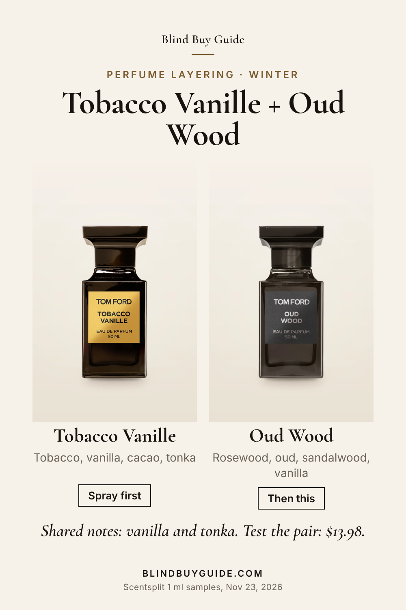

- **Look:** control
- **Board:** Winter Perfumes
- **Post:** #9 (day 5)
- **Title:** Winter perfume layering: Tobacco Vanille + Oud Wood
- **Description:** A winter perfume layering combination from one house: Tom Ford Tobacco Vanille and Tom Ford Oud Wood both list vanilla and tonka bean, so the pair has a bridge. Spray Tobacco Vanille first, Oud Wood over it, one or two sprays each. Test the pair for $13.98 in samples before two $300 bottles. Affiliate links on the page. #ad #perfumelayering
- **Destination URL:** https://www.blindbuyguide.com/guides/perfume-layering-combinations/
- **Alt text:** Two Tom Ford bottles side by side on cream under the headline 'Tobacco Vanille + Oud Wood.' Left: Tobacco Vanille, tobacco, vanilla, cacao, tonka, spray first. Right: Oud Wood, rosewood, oud, sandalwood, vanilla, spray second. Shared notes: vanilla and tonka. Two 1 ml samples cost $13.98.

### 34. Tobacco Vanille + Oud Wood layering · A, ingredient photo

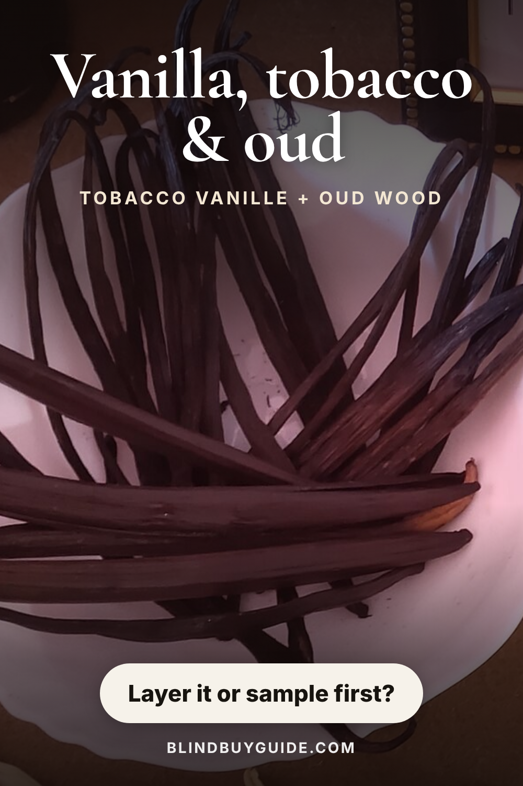

- **Look:** A
- **Board:** Winter Perfumes
- **Post:** #1 (day 1)
- **Title:** Winter perfume layering: Tobacco Vanille + Oud Wood
- **Description:** A winter perfume layering combination from one house: Tom Ford Tobacco Vanille and Tom Ford Oud Wood both list vanilla and tonka bean, so the pair has a bridge. Spray Tobacco Vanille first, Oud Wood over it, one or two sprays each. Test the pair for $13.98 in samples before two $300 bottles. Affiliate links on the page. #ad #perfumelayering
- **Destination URL:** https://www.blindbuyguide.com/guides/perfume-layering-combinations/
- **Alt text:** Full-bleed photo of dark cured vanilla pods piled in a white bowl. Headline: 'Vanilla, tobacco & oud.' Below: 'Tobacco Vanille + Oud Wood.' Button: 'Layer it or sample first?' blindbuyguide.com.

### 35. Tobacco Vanille + Oud Wood layering · B, verdict poster

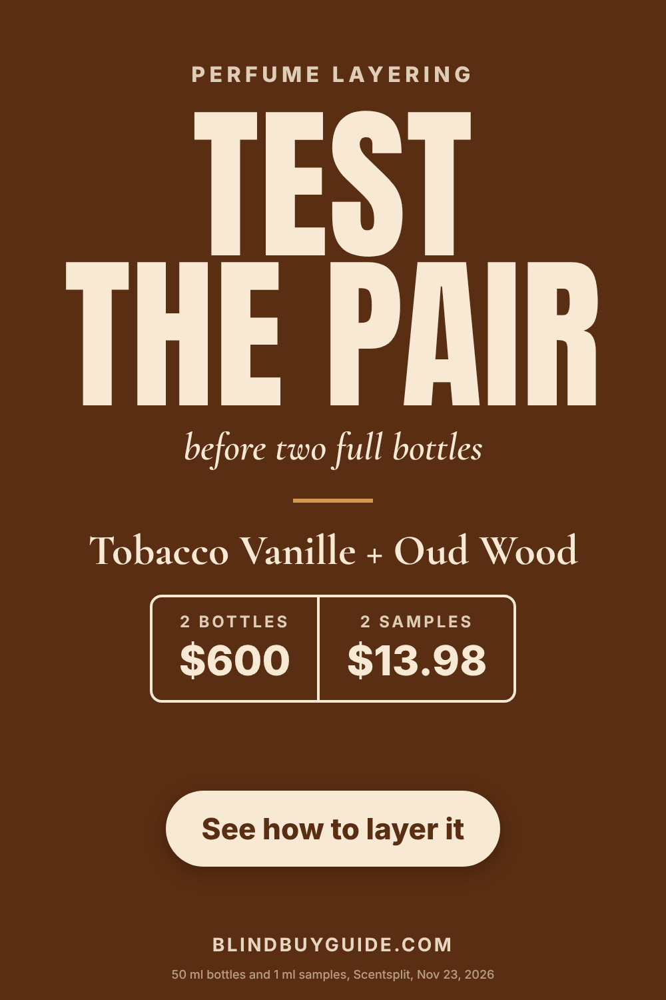

- **Look:** B
- **Board:** Winter Perfumes
- **Post:** #5 (day 3)
- **Title:** Winter perfume layering: Tobacco Vanille + Oud Wood
- **Description:** A winter perfume layering combination from one house: Tom Ford Tobacco Vanille and Tom Ford Oud Wood both list vanilla and tonka bean, so the pair has a bridge. Spray Tobacco Vanille first, Oud Wood over it, one or two sprays each. Test the pair for $13.98 in samples before two $300 bottles. Affiliate links on the page. #ad #perfumelayering
- **Destination URL:** https://www.blindbuyguide.com/guides/perfume-layering-combinations/
- **Alt text:** Bold poster in deep tobacco brown. Huge condensed type: 'Test the pair.' Italic: 'before two full bottles.' Tobacco Vanille + Oud Wood. Two 50 ml bottles $600; two 1 ml samples $13.98. Button: 'See how to layer it.' blindbuyguide.com.

### 36. Baccarat Rouge 540 notes · Control

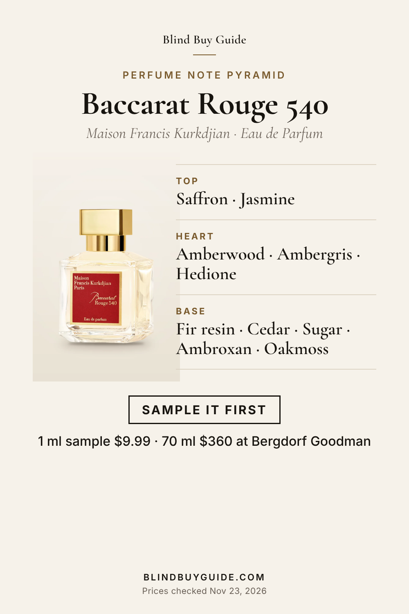

- **Look:** control
- **Board:** Perfume Note Pyramids
- **Post:** #6 (day 3)
- **Title:** Baccarat Rouge 540 notes: the full perfume note pyramid
- **Description:** Baccarat Rouge 540 notes, top to base: saffron and jasmine, then amberwood, ambergris and hedione, on fir resin, cedar and ambroxan. See the full Maison Francis Kurkdjian note pyramid, our sample-first verdict, and what a 1 ml sample costs before the $360 bottle (prices checked Nov 23, 2026). Affiliate links on the page. #ad #perfumenotes
- **Destination URL:** https://www.blindbuyguide.com/scents/baccarat-rouge-540-edp/
- **Alt text:** Perfume note pyramid for Maison Francis Kurkdjian Baccarat Rouge 540 Eau de Parfum beside a photo of the bottle on a cream background. Top notes: saffron, jasmine. Heart: amberwood, ambergris, hedione. Base: fir resin, cedar, sugar, ambroxan, oakmoss. Verdict: sample it first. 1 ml sample $9.99; 70 ml $360 at Bergdorf Goodman.

### 37. Baccarat Rouge 540 notes · A, ingredient photo

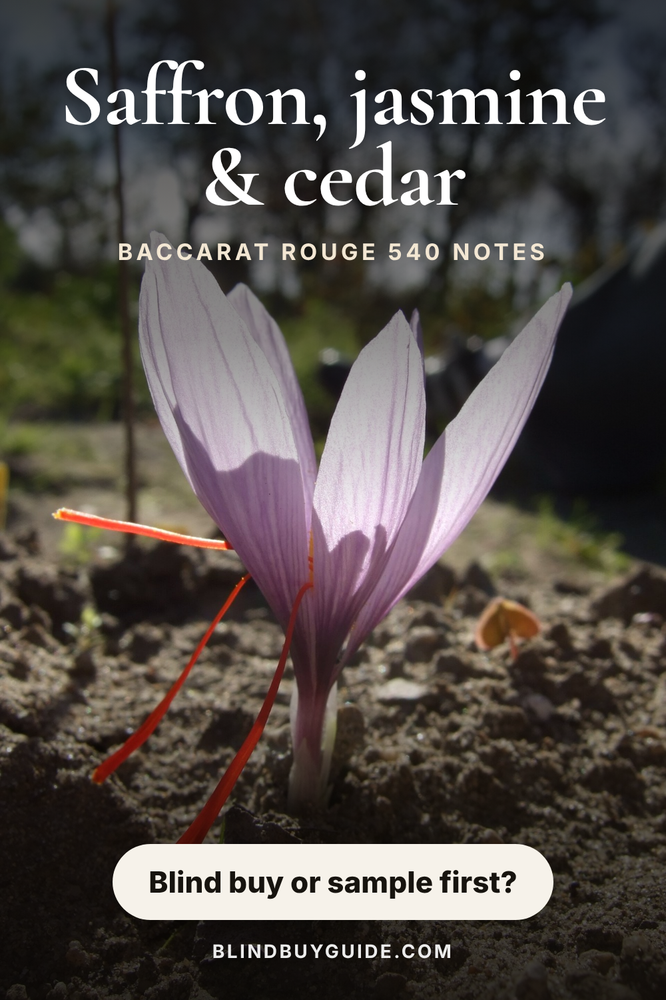

- **Look:** A
- **Board:** Perfume Note Pyramids
- **Post:** #10 (day 7)
- **Title:** Baccarat Rouge 540 notes: the full perfume note pyramid
- **Description:** Baccarat Rouge 540 notes, top to base: saffron and jasmine, then amberwood, ambergris and hedione, on fir resin, cedar and ambroxan. See the full Maison Francis Kurkdjian note pyramid, our sample-first verdict, and what a 1 ml sample costs before the $360 bottle (prices checked Nov 23, 2026). Affiliate links on the page. #ad #perfumenotes
- **Destination URL:** https://www.blindbuyguide.com/scents/baccarat-rouge-540-edp/
- **Alt text:** Full-bleed photo of a purple saffron crocus with red saffron threads, growing in soil. Headline: 'Saffron, jasmine & cedar.' Below: 'Baccarat Rouge 540 notes.' Button: 'Blind buy or sample first?' blindbuyguide.com.

### 38. Baccarat Rouge 540 notes · B, verdict poster

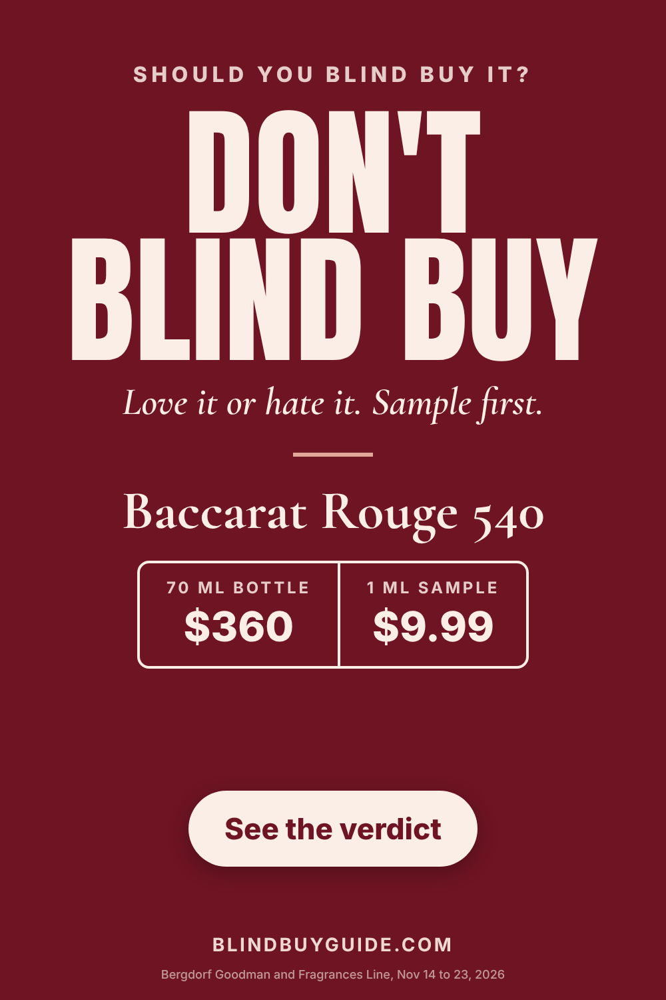

- **Look:** B
- **Board:** Perfume Note Pyramids
- **Post:** #2 (day 1)
- **Title:** Baccarat Rouge 540 notes: the full perfume note pyramid
- **Description:** Baccarat Rouge 540 notes, top to base: saffron and jasmine, then amberwood, ambergris and hedione, on fir resin, cedar and ambroxan. See the full Maison Francis Kurkdjian note pyramid, our sample-first verdict, and what a 1 ml sample costs before the $360 bottle (prices checked Nov 23, 2026). Affiliate links on the page. #ad #perfumenotes
- **Destination URL:** https://www.blindbuyguide.com/scents/baccarat-rouge-540-edp/
- **Alt text:** Bold poster in oxblood red. Huge condensed type: 'Don't blind buy.' Italic: 'Love it or hate it. Sample first.' Baccarat Rouge 540. 70 ml bottle $360; 1 ml sample $9.99. Button: 'See the verdict.' blindbuyguide.com.

### 39. Ombré Leather safe blind buy · Control

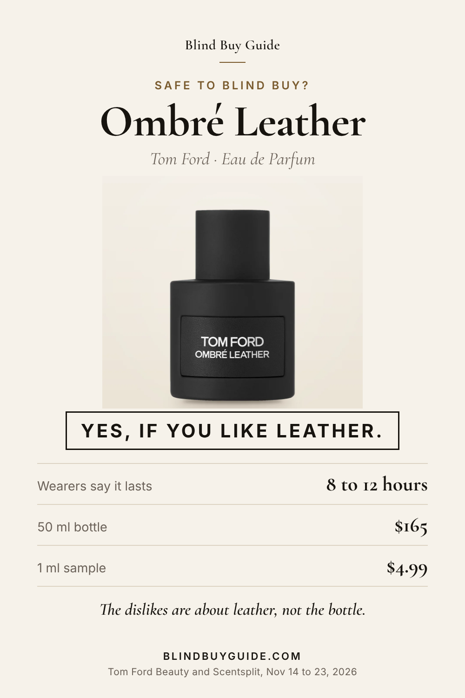

- **Look:** control
- **Board:** Designer Perfumes
- **Post:** #3 (day 1)
- **Title:** Is Tom Ford Ombré Leather a safe blind buy? Yes, if you like leather
- **Description:** Is Tom Ford Ombré Leather a safe blind buy? It's the one full bottle on our safe list: wearer opinion is unusually consistent, the occasional dislike is about leather itself, and most report 8 to 12 hours. $165 for 50 ml at Tom Ford Beauty (Nov 14, 2026). Not sure about leather? A 1 ml sample is $4.99. Affiliate links on the page. #ad #tomford
- **Destination URL:** https://www.blindbuyguide.com/guides/safe-blind-buy-perfumes/
- **Alt text:** Photo of a Tom Ford Ombré Leather Eau de Parfum bottle on cream under the headline 'Ombré Leather.' The answer reads 'Yes, if you like leather.' Wearers say 8 to 12 hours. 50 ml bottle $165. 1 ml sample $4.99.

### 40. Ombré Leather safe blind buy · A, ingredient photo

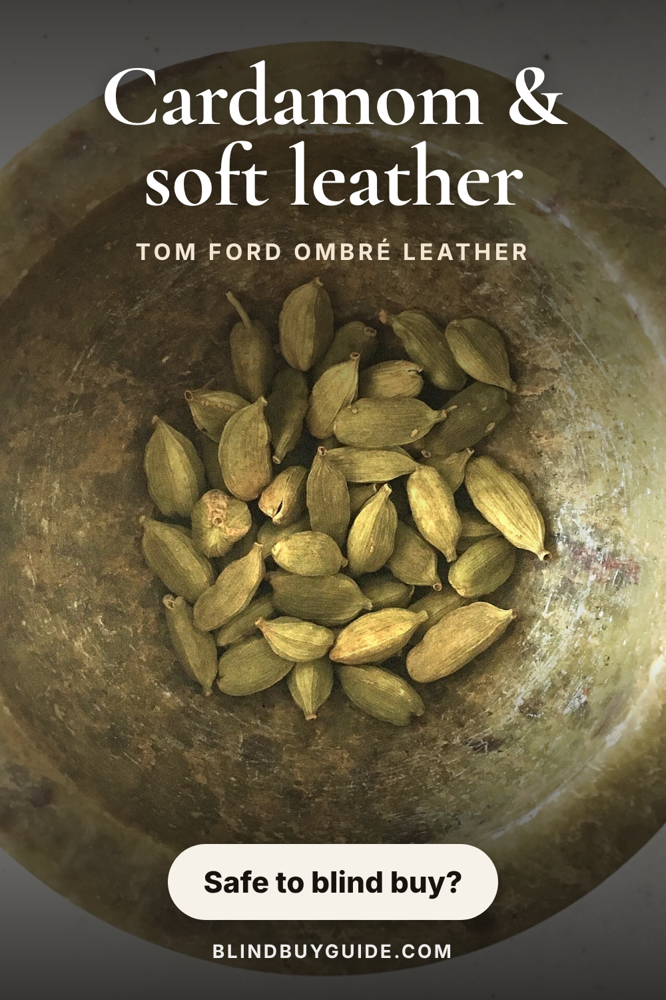

- **Look:** A
- **Board:** Designer Perfumes
- **Post:** #7 (day 5)
- **Title:** Is Tom Ford Ombré Leather a safe blind buy? Yes, if you like leather
- **Description:** Is Tom Ford Ombré Leather a safe blind buy? It's the one full bottle on our safe list: wearer opinion is unusually consistent, the occasional dislike is about leather itself, and most report 8 to 12 hours. $165 for 50 ml at Tom Ford Beauty (Nov 14, 2026). Not sure about leather? A 1 ml sample is $4.99. Affiliate links on the page. #ad #tomford
- **Destination URL:** https://www.blindbuyguide.com/guides/safe-blind-buy-perfumes/
- **Alt text:** Full-bleed overhead photo of green cardamom pods in a stone mortar. Headline: 'Cardamom & soft leather.' Below: 'Tom Ford Ombré Leather.' Button: 'Safe to blind buy?' blindbuyguide.com.

### 41. Ombré Leather safe blind buy · B, verdict poster

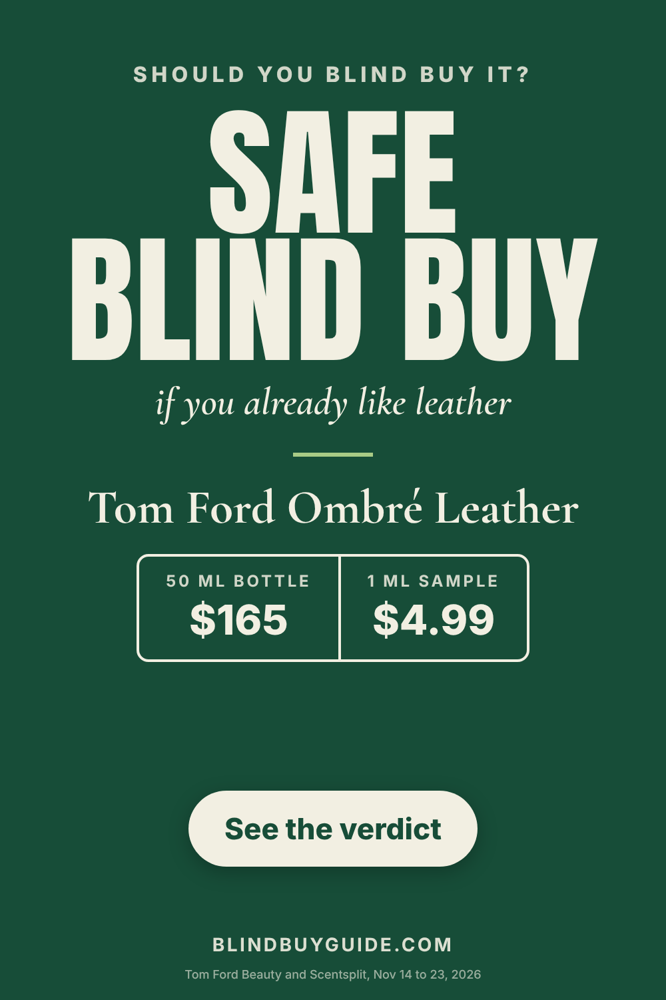

- **Look:** B
- **Board:** Designer Perfumes
- **Post:** #11 (day 7)
- **Title:** Is Tom Ford Ombré Leather a safe blind buy? Yes, if you like leather
- **Description:** Is Tom Ford Ombré Leather a safe blind buy? It's the one full bottle on our safe list: wearer opinion is unusually consistent, the occasional dislike is about leather itself, and most report 8 to 12 hours. $165 for 50 ml at Tom Ford Beauty (Nov 14, 2026). Not sure about leather? A 1 ml sample is $4.99. Affiliate links on the page. #ad #tomford
- **Destination URL:** https://www.blindbuyguide.com/guides/safe-blind-buy-perfumes/
- **Alt text:** Bold poster in deep green. Huge condensed type: 'Safe blind buy.' Italic: 'if you already like leather.' Tom Ford Ombré Leather. 50 ml bottle $165; 1 ml sample $4.99. Button: 'See the verdict.' blindbuyguide.com.

### 42. Delina worth it · Control

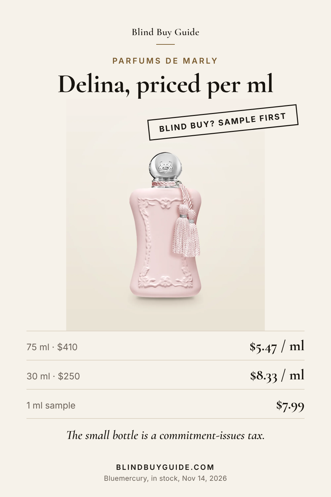

- **Look:** control
- **Board:** Niche Perfumes
- **Post:** #12 (day 7)
- **Title:** Is Parfums de Marly Delina worth it? Price per ml, by bottle size
- **Description:** Is Parfums de Marly Delina worth it? Sample it first, then go big: the 75 ml at $410 (Bluemercury) works out to $5.47 per ml, against $8.33 per ml for the 30 ml at $250 (Nov 14, 2026). A 1 ml sample is $7.99. Notes include lychee, rhubarb, Turkish rose, peony, cashmeran and vetiver. Affiliate links on the page. #ad #nicheperfume
- **Destination URL:** https://www.blindbuyguide.com/guides/is-delina-edp-worth-it/
- **Alt text:** Editorial photo of the pink Parfums de Marly Delina Eau de Parfum bottle on a cream background with a small stamp reading 'Blind buy? Sample first.' Caption: 75 ml at $410 is $5.47 per ml; 30 ml at $250 is $8.33 per ml; 1 ml sample $7.99.

### 43. Delina worth it · A, ingredient photo

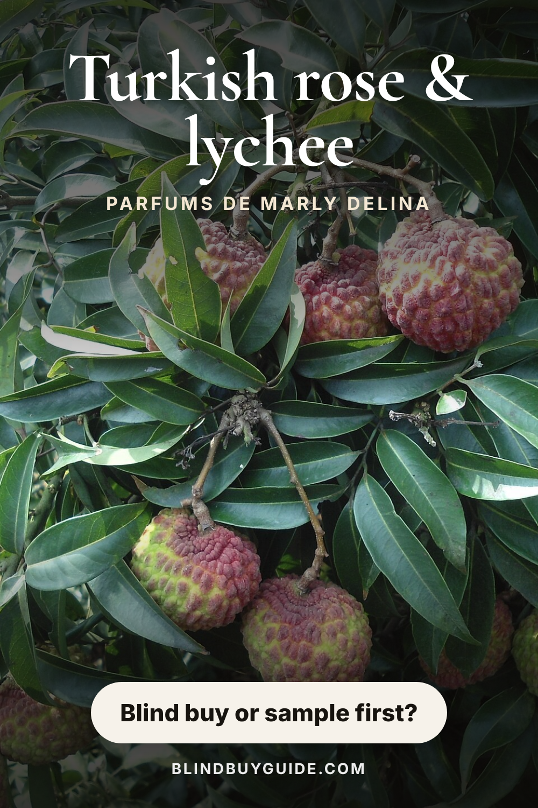

- **Look:** A
- **Board:** Niche Perfumes
- **Post:** #4 (day 3)
- **Title:** Is Parfums de Marly Delina worth it? Price per ml, by bottle size
- **Description:** Is Parfums de Marly Delina worth it? Sample it first, then go big: the 75 ml at $410 (Bluemercury) works out to $5.47 per ml, against $8.33 per ml for the 30 ml at $250 (Nov 14, 2026). A 1 ml sample is $7.99. Notes include lychee, rhubarb, Turkish rose, peony, cashmeran and vetiver. Affiliate links on the page. #ad #nicheperfume
- **Destination URL:** https://www.blindbuyguide.com/guides/is-delina-edp-worth-it/
- **Alt text:** Full-bleed photo of ripe pink-red lychees hanging among green leaves. Headline: 'Turkish rose & lychee.' Below: 'Parfums de Marly Delina.' Button: 'Blind buy or sample first?' blindbuyguide.com.

### 44. Delina worth it · B, verdict poster

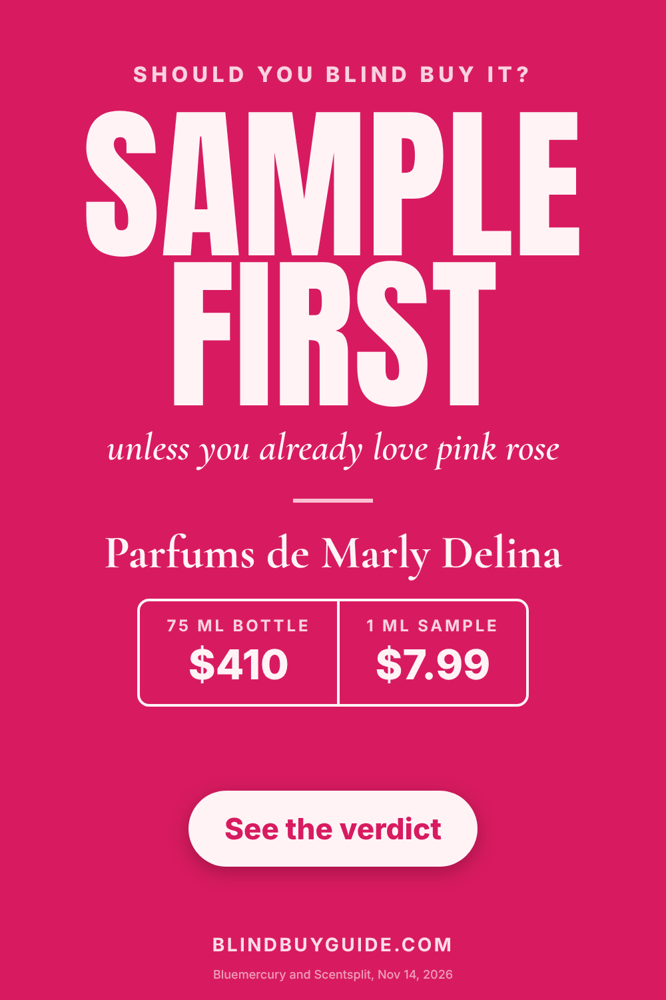

- **Look:** B
- **Board:** Niche Perfumes
- **Post:** #8 (day 5)
- **Title:** Is Parfums de Marly Delina worth it? Price per ml, by bottle size
- **Description:** Is Parfums de Marly Delina worth it? Sample it first, then go big: the 75 ml at $410 (Bluemercury) works out to $5.47 per ml, against $8.33 per ml for the 30 ml at $250 (Nov 14, 2026). A 1 ml sample is $7.99. Notes include lychee, rhubarb, Turkish rose, peony, cashmeran and vetiver. Affiliate links on the page. #ad #nicheperfume
- **Destination URL:** https://www.blindbuyguide.com/guides/is-delina-edp-worth-it/
- **Alt text:** Bold poster in hot pink. Huge condensed type: 'Sample first.' Italic: 'unless you already love pink rose.' Parfums de Marly Delina. 75 ml bottle $410; 1 ml sample $7.99. Button: 'See the verdict.' blindbuyguide.com.

## Before posting

1. Prices are dated Nov 14 to 23, 2026. If you post after about Dec 7, ask Claude to re-check and re-render.
2. Open each landing page on your phone once.
3. Add the posting date for each pin in [../TESTING.md](../TESTING.md) so the day-21 and day-45 reads land on the right dates.
